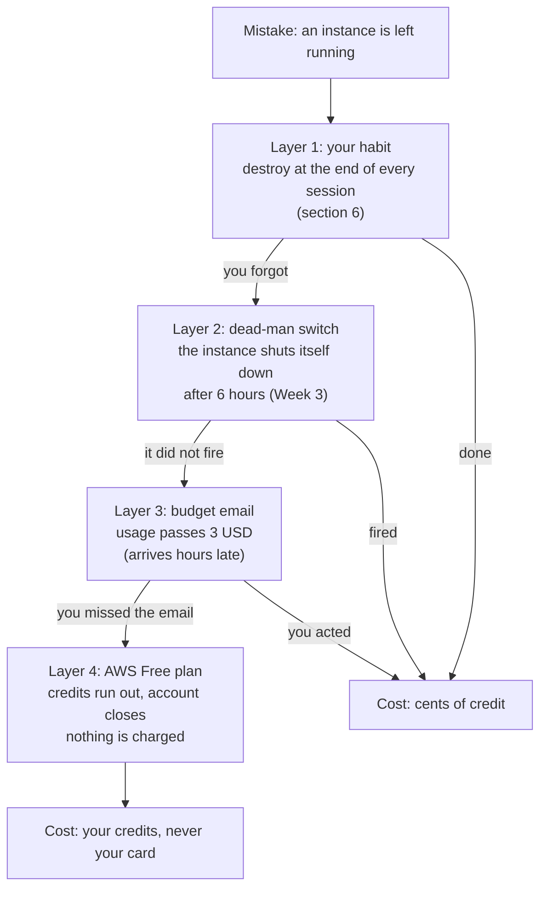

# Cost Safety: How This Project Stays at Zero

**Read this before Week 1, task 1.2, and again before Week 3.** It is short on purpose. The end-of-session checklist in section 6 is the part you will use every working day from Week 3 onward.

The rule for the whole assignment: **you never pay anything.** Not "a few dollars". Nothing. Every choice below exists to make that true even on a day when you make a mistake.

## 1. How the protection is layered

No single safeguard is trusted. Four independent layers sit between a mistake and a bill, and each one works even if the layer above it fails.



Layer 4 only exists on the **Free plan**. That is why checking your plan is the first thing you do.

## 2. Know which plan you are on

AWS accounts created since July 2025 are on one of two plans.

| | Free plan | Paid plan |
| --- | --- | --- |
| Credits | 100 USD at sign-up, up to 100 USD more for activities | The same |
| Can it charge your card? | **No** | **Yes**, once credits are used |
| When credits or six months run out | The account closes. Data is kept 90 days. | Billing continues at normal rates |
| Instance types you can launch | Only the Free Tier eligible list | Anything |

Check it (task 1.2 does this through `scripts/aws-preflight.sh`):

```bash
aws freetier get-account-plan-state
```

`accountPlanType` is `FREE` or `PAID`. The same call returns your remaining credits and the expiry date.

**If it says PAID:** stop. Nothing is wrong yet, but layer 4 does not exist for you. You can still do the whole assignment at zero cost inside the credits, but treat section 6 as non-negotiable and create both budgets in section 3 before you create anything else. I could not find a documented way to move an account from the Paid plan back to the Free plan; if the console offers one to you, take it.

**Never click "Upgrade plan".** Some console pages suggest it when you touch a service the Free plan does not include. Nothing in this assignment needs it. If a page asks you to upgrade, you have wandered outside the kit: close the tab.

## 3. One-time setup (Week 1, task 1.2)

Do these in order. Budget about 90 minutes including waiting for emails.

### 3.1 Lock the front door

1. Turn on **MFA for the root user** (console, top-right menu, Security credentials). Use an authenticator app.
2. Create **one IAM user for yourself** with console access, attach the AWS managed policy `AdministratorAccess`, and turn on MFA for it too. Sign out of root and use this user from now on.
3. **Create no access keys.** Not for root, not for the user, not "just to test". This project never needs one:
   - your laptop signs in with `aws login`, which hands the CLI short-lived credentials;
   - the pipelines use OIDC, which hands each job short-lived credentials.

A long-lived key that does not exist cannot be committed, leaked or stolen. That is the whole strategy.

### 3.2 Sign in from the terminal

```bash
aws --version          # must be 2.32.0 or newer
aws login              # opens the browser; choose your IAM user
aws sts get-caller-identity
```

In WSL the browser may not open. Use `aws login --remote`: it prints a URL, you open it in your Windows browser, and paste the code back. A session lasts at most 12 hours, then you run `aws login` again.

### 3.3 Run the preflight

```bash
scripts/aws-preflight.sh
```

It only reads. It tells you which identity you are, the plan and credits, the vCPU quota, the instance types you may launch, and whether any budget exists. Paste its output into `NOTES.md`; it is your baseline.

### 3.4 Check the vCPU quota now, not in Week 3

Every Free Tier eligible instance type has 2 vCPUs. New accounts are frequently created with an On-Demand quota of **1**, which makes all of them impossible to launch. Raising it is free but not instant, which is why you look today.

```bash
aws service-quotas get-service-quota \
  --service-code ec2 --quota-code L-1216C47A --region us-east-1 \
  --query 'Quota.Value'
```

If the answer is below 2:

```bash
aws service-quotas request-service-quota-increase \
  --service-code ec2 --quota-code L-1216C47A --region us-east-1 \
  --desired-value 2
```

Ask for 2, the minimum you need; small requests on new accounts are the ones that get approved. Check the status in the Service Quotas console under "Quota request history". If it is still pending or was declined after a week, read "Plan B" in the execution guidelines, section 7.

### 3.5 Create a budget that can actually see your usage

Here is the trap. AWS Budgets subtracts credits from cost by default. On an account living on credits, your cost after credits is always zero, so an ordinary budget never fires while your credits drain.

Create a budget that **excludes credits**, so it measures what you used rather than what you were charged. Replace the email address:

```bash
ACCOUNT_ID="$(aws sts get-caller-identity --query Account --output text)"
EMAIL="you@example.com"

aws budgets create-budget \
  --account-id "$ACCOUNT_ID" \
  --budget '{
    "BudgetName": "parcelo-usage-before-credits",
    "BudgetLimit": {"Amount": "10", "Unit": "USD"},
    "TimeUnit": "MONTHLY",
    "BudgetType": "COST",
    "CostTypes": {
      "IncludeCredit": false, "IncludeRefund": false,
      "IncludeTax": true, "IncludeSubscription": true, "UseBlended": false,
      "IncludeUpfront": true, "IncludeRecurring": true,
      "IncludeOtherSubscription": true, "IncludeSupport": true,
      "IncludeDiscount": true, "UseAmortized": false
    }
  }' \
  --notifications-with-subscribers "[
    {\"Notification\": {\"NotificationType\": \"ACTUAL\", \"ComparisonOperator\": \"GREATER_THAN\", \"Threshold\": 30, \"ThresholdType\": \"PERCENTAGE\"},
     \"Subscribers\": [{\"SubscriptionType\": \"EMAIL\", \"Address\": \"$EMAIL\"}]},
    {\"Notification\": {\"NotificationType\": \"ACTUAL\", \"ComparisonOperator\": \"GREATER_THAN\", \"Threshold\": 100, \"ThresholdType\": \"PERCENTAGE\"},
     \"Subscribers\": [{\"SubscriptionType\": \"EMAIL\", \"Address\": \"$EMAIL\"}]}
  ]"
```

What this gives you: an email when gross usage in a month passes 3 USD, and another at 10 USD. The whole assignment should use about 4 USD of credits in total (section 4), so the first email means "look now" and the second means "something is running that should not be".

Then add a second budget from the console using the **Zero spend budget** template. That one keeps the default behaviour (credits included), so it fires only if real money is ever charged. On the Free plan it should stay silent for ever. On the Paid plan it is the alarm that matters.

Two honest limits:

- **Budgets are slow.** AWS refreshes budget data up to three times a day, so an alert can be 8 to 12 hours behind reality. A budget tells you about yesterday. It cannot stop anything.
- **I validated the command's structure against the official API model, but never ran it against an account.** If AWS rejects it, the error names the field; fix that field and note it in `NOTES.md`.

Confirm the subscription email if AWS sends one, and check your spam folder for the first alert.

## 4. What costs credits in this project

Approximate On-Demand prices in `us-east-1`. I could verify the public IPv4 price on 12 November 2026; the others are from the published price list as I know it, so check them on the AWS pricing pages before Week 3.

| Resource | When it bills | Approximate price | In this project |
| --- | --- | --- | --- |
| EC2 instance, `c7i-flex.large` | Every second it is **running** | 0.085 USD per hour | One, only during work sessions |
| Public IPv4 address | Every hour it exists, used or idle | 0.005 USD per hour | One, attached to the instance |
| EBS disk, 20 GB gp3 | Every hour it exists, **even if the instance is stopped** | 0.002 USD per hour | One, deleted with the instance |
| S3 state bucket | Per GB stored | well under 0.01 USD per month | Stays for the whole project |
| IAM roles, OIDC provider, security groups, VPC, subnet, route table, internet gateway | Never | 0 | Free |
| Systems Manager Session Manager and Run Command | Never, for EC2 instances | 0 | Free |
| Data transfer out | Per GB after a monthly free allowance | 0 at this scale | Negligible |

Per session:

$$0.085 + 0.005 + 0.002 \approx 0.092 \text{ USD per hour}$$

A four-hour session costs about 37 US cents of credit. Ten sessions across Weeks 3 to 5 cost under 4 USD. You have 100.

### Never create these

Each one bills by the hour and none is needed here. If Terraform ever plans one, something has gone wrong.

| Do not create | Why it hurts |
| --- | --- |
| NAT gateway | About 0.045 USD per hour plus data, for ever, with nothing running behind it. The classic surprise bill. |
| Elastic IP left unattached | Bills like any public IPv4 address, while doing nothing. |
| Load balancer (ALB or NLB) | Bills per hour. k3s's built-in ServiceLB is used instead. |
| EKS cluster | The control plane bills per hour before you run a single pod. |
| RDS database | Bills per hour, and its storage bills even when stopped. PostgreSQL runs in the cluster. |
| A second region | Doubles every way you can forget something. One region, always. |

## 5. Free limits that apply to you

| Service | Limit | What happens at the limit |
| --- | --- | --- |
| AWS Free plan | 100 USD credits (up to 200), six months from account creation | Account closes; nothing is charged |
| EC2 on the Free plan | Only `t3.micro`, `t3.small`, `t4g.micro`, `t4g.small`, `c7i-flex.large`, `m7i-flex.large` | Other types refuse to launch |
| EC2 vCPU quota | Often 1 on a new account | Launch fails with a vCPU limit error (section 3.4) |
| GitHub Actions | Free on standard runners for **public** repositories | Nothing; this is why the repository is public |
| GitHub Container Registry | Free for **public** packages | Nothing. Packages start **private**; you make them public once, and that cannot be undone |
| GitHub environments with required reviewers | Available on public repositories on the Free plan | Nothing |
| Docker Desktop | Free for personal use and education | Nothing |
| Docker Hub pulls | 100 per 6 hours without logging in, 200 with a free account | Builds fail with `toomanyrequests`; run `docker login` |

Write your account's expiry date here once the preflight has printed it: `____-__-__`. The cloud deployment is temporary by design. Your portfolio is the repository and the demo recording, not a server that stays up.

## 6. End-of-session checklist

**Every session that touched AWS ends with this. No exceptions, including the session where you are tired and it is almost working.** It takes about five minutes.

Copy it into `NOTES.md` and tick it each time.

```text
[ ] 1. Destroy the infra stack
       GitHub > Actions > terraform > Run workflow > action: destroy > approve
       (before task 3.9 exists: terraform destroy in terraform/infra, from your laptop)
[ ] 2. Wait for the run to finish GREEN. A cancelled or failed destroy has destroyed nothing.
[ ] 3. scripts/end-of-session.sh
       Expected: no instances, no volumes, no addresses, no NAT gateways, no load balancers.
[ ] 4. Read the remaining credits it prints. Write the number in the cost log below.
[ ] 5. aws logout
[ ] 6. Laptop only (frees memory, costs nothing): kind delete cluster --name parcelo ; docker compose down
```

What is allowed to remain after a clean teardown: the `bootstrap` stack (state bucket, three IAM roles, the OIDC provider). Together they cost a fraction of a cent per month, and without them you could not rebuild.

If step 3 finds something, do not delete it by hand first. Ask why Terraform did not remove it: was it created outside Terraform, in another region, or did the destroy fail halfway? Fix the cause, then remove it (with Terraform if it is in state, in the console if it is not), and write one line about it in `NOTES.md`.

### Cost log

Keep this table in `NOTES.md`. It becomes your Week 5 cost report with no extra work.

| Date | Hours instance was up | Credits before | Credits after | Anything left running? | Notes |
| --- | --- | --- | --- | --- | --- |
| | | | | | |

## 7. Once a week

Five minutes, during the weekly self-review.

1. Billing console, **Credits** page: does the remaining amount match your log?
2. Billing console, **Bills** page for the current month: is every line a service you recognise? An unfamiliar service name is the earliest sign of a mistake.
3. `REGIONS="us-east-1 us-east-2 us-west-2 ap-south-1" scripts/end-of-session.sh` to catch anything created in the wrong region by a slip of a dropdown.
4. Any budget emails this week? If yes, write down what caused them.

## 8. When something goes wrong

| Situation | Do this, in this order |
| --- | --- |
| **A budget email arrives** | 1. Run `scripts/end-of-session.sh`. 2. Destroy whatever it finds. 3. Work out which layer failed (habit or dead-man switch) and write it down. An alert is the system working, not a disaster. |
| **Credits are dropping faster than your log explains** | 1. Bills page: find the service. 2. Check other regions (section 7, step 3). 3. If you cannot find the cause in 30 minutes, destroy everything except the state bucket and open a billing support case; billing support is free on every plan. |
| **`terraform destroy` fails** | 1. Read the error; usually one resource depends on another. Run it again. 2. Still failing: terminate the instance in the console (that stops almost all cost immediately), then fix Terraform calmly. 3. Afterwards, `terraform plan` shows what state still believes exists. |
| **You pushed a secret to GitHub** | 1. Treat it as stolen, even if you deleted the commit seconds later. 2. Revoke or rotate it at its source first. 3. Only then clean the history. This project has no long-lived AWS keys, so the realistic cases are a personal access token or a database password in a file. Week 1 drills this with a fake secret so the real thing is not your first time. |
| **A console page asks you to upgrade your plan** | Close it. Nothing in this kit needs the Paid plan. |
| **The dead-man switch shut the instance down mid-session** | Working as designed. Run the terraform workflow with `apply` to get a fresh one, or raise `auto_shutdown_minutes` for a long session and lower it again afterwards. |

## 9. At the end of the project

After the final demo is recorded (task 5.7):

1. Run the end-of-session checklist one last time.
2. Decide about the `bootstrap` stack. Leaving it costs essentially nothing and lets you rebuild for an interview. Removing it means deleting the state bucket on purpose: you must remove `prevent_destroy`, empty every version of every object in the bucket, then `terraform destroy` in `terraform/bootstrap`. Write down which you chose and why.
3. Note the Free plan expiry date in your README, so future you is not surprised when the account closes.
4. Record the final numbers in the cost report: total credits used, total instance hours, and what the same setup would cost per month if it ran all day. That last number is the one an interviewer will ask about.
