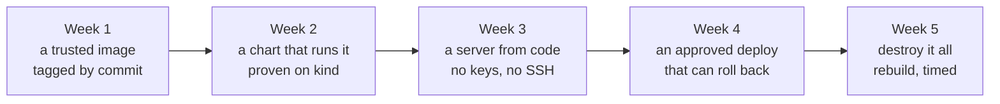
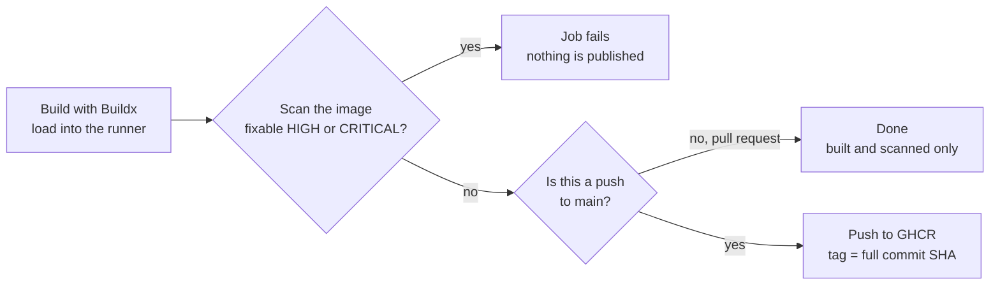
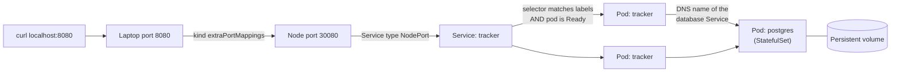
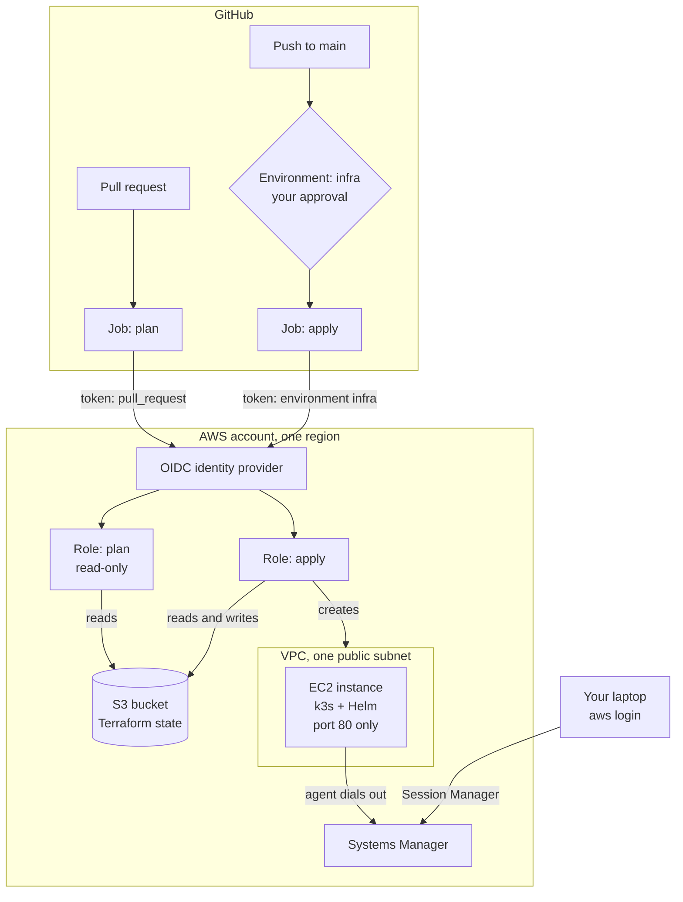
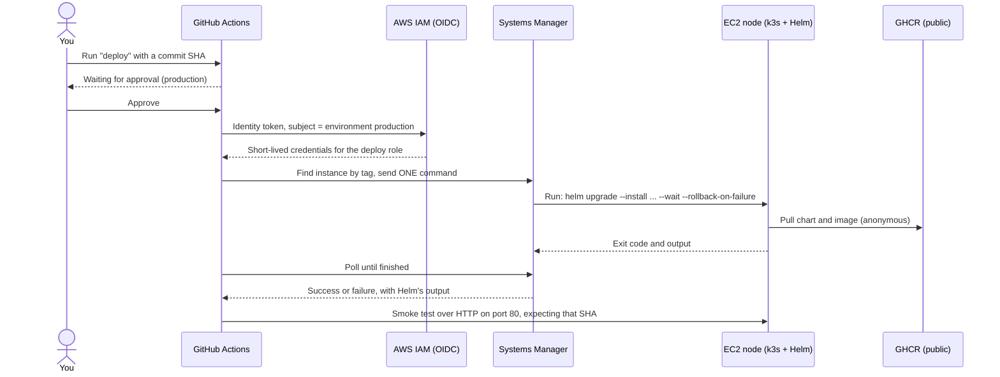
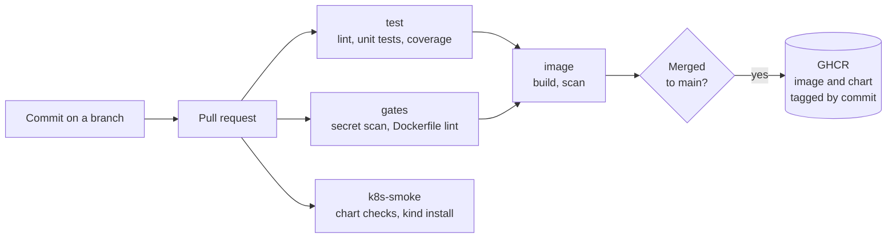
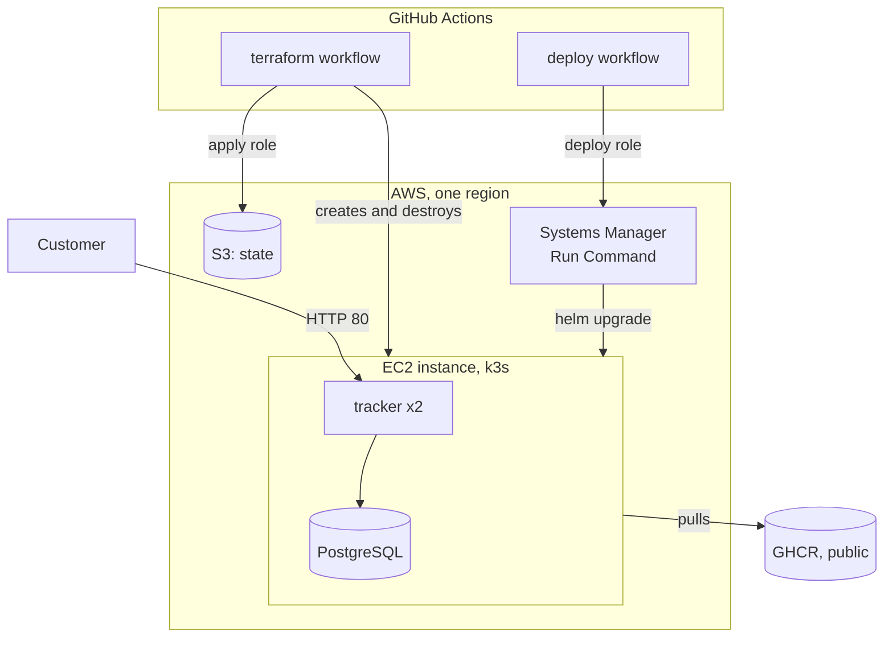
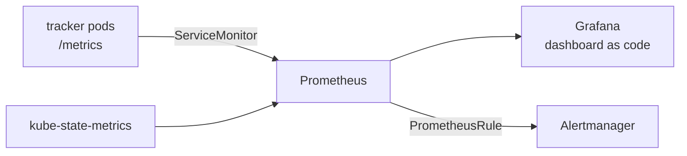

# Parcelo: Execution Guidelines

**Your main working document.** Keep it open. Work through it in order.

## Contents

1. What this assignment is for
2. How the 5 weeks are structured
3. Ground rules (working style, getting unstuck, AI tools, git, cost)
4. Project setup: do this on Day 1
5. Week 1: CI and containers
6. Week 2: Kubernetes on the laptop
7. Week 3: Terraform on AWS
8. Week 4: Deploy and observe
9. Week 5: Prove it
10. Tracking tables
11. Final deliverables checklist
12. Evaluation
13. Appendix A: Suggested project structure
14. Appendix B: Reference architecture
15. Appendix C: Glossary
16. Appendix D: Learning resources
17. Appendix E: Common mistakes that cost days

# 1. What This Assignment Is For

You are given a small, finished, tested backend service. You are going to build everything that stands between that code and a customer: the checks, the packaging, the infrastructure, the deployment and the monitoring.

This is the reverse of your last assignment. There, the infrastructure was handed to you and you wrote the application. Here, the application is handed to you and you write the infrastructure. You will write almost no Python.

The point is **not** to touch as many tools as possible. The point is to come out of five weeks able to say, honestly:

- "I know what has to be true before a change is allowed into `main`, and I have watched every one of those gates stop a bad change."
- "I know what is inside my container image, who it runs as, and how I would find out it had a known vulnerability."
- "I know what Kubernetes does when a pod fails its health check, and why a bad release never received a request."
- "I know how a pipeline obtains cloud credentials without any secret being stored, and exactly what each identity is allowed to do."
- "I can destroy everything I built and rebuild it from the repository, and I know how long that takes."
- "I know how I would find out the service is unhealthy before a customer tells me, and what it costs to run."

Those six sentences are the syllabus. Every requirement exists to serve one of them.

# 2. How the 5 Weeks Are Structured

| Week | Theme | Part | Where it runs | Cloud cost | Difficulty |
| --- | --- | --- | --- | --- | --- |
| 1 | CI and containers | A | Laptop, GitHub | None | Warm-up |
| 2 | Kubernetes on the laptop | A | Laptop, GitHub | None | Where it gets real |
| 3 | Terraform on AWS | B | AWS | Cents of credit | Hardest week |
| 4 | Deploy and observe | B | AWS, laptop | Cents of credit | New territory |
| 5 | Prove it | B | AWS, laptop | Cents of credit | Wrap-up |

Each week produces the thing the next week needs:



Weeks 1 to 3 are the spine. If you are behind at the end of Week 2, you cut SHOULD items from Weeks 3 and 4 (Argo CD first, then the Terraform linters, then the SBOM). You never start Week 3 with a Week 1 or Week 2 MUST still failing.

**The budget is 22 hours a week.** Each week's task table adds up to **20 hours of tasks plus 2 hours of buffer**:

$$5 \times (20 + 2) = 110 \text{ hours}$$

The estimates include the SHOULD items. If one task takes double its estimate, stop and use the stuck protocol in section 3.2; do not push through silently. If the buffer is gone by the middle of the week, drop a SHOULD and write down that you did.

Each week follows the same loop. With 22 hours, think of it as five sessions of about four hours and one short one:

- **Session 1.** Read the week's section here and the matching requirements in the brief. Skim the week's learning resources for at most 90 minutes. Write your task plan in `NOTES.md`.
- **Sessions 2 to 4.** Build. Commit every session. Ask for help by the rules in section 3.2.
- **Session 5.** Check the Definition of Done, run the drills, update the documents.
- **Short session.** Self-review (`assignment/self-review.md`, 90 minutes), open the pull request, merge, and from Week 3 run the teardown checklist.
- **Fix review findings before starting the next week.** The next week sits directly on top of this one.

# 3. Ground Rules

## 3.1 Working style

- **One change at a time.** Change one thing, run it, read the result, commit. Pipelines and clusters punish batches of five changes, because you cannot tell which one broke it.
- **Commit every session.** A week with one giant commit on the last day cannot be reviewed, by you or by an AI.
- **Read the error message.** Then the lines above it. Most pipeline failures state their cause exactly, twenty lines up from where the red text starts.
- **Print, do not guess.** An image name, a token subject, an instance id: print the real value and copy it.
- **Keep `NOTES.md`.** What you tried, what confused you, what you decided and why, and how long each task really took. It is also where your drill evidence and cost log live.
- **Do not polish on the last day.** Ship, review, then improve.

## 3.2 The 45-minute rule, without a mentor

You are expected to struggle a bit. That is the learning. You are **not** expected to lose a day.

- **Stuck for 45 minutes on the same error with no progress?** Stop typing. Write in `NOTES.md`: what you are trying to do, what you expected, what happened (the exact error text), and what you have already tried. Writing it down properly solves about one problem in three.
- **Then look it up in this order:** the official documentation for the version you pinned; the tool's issue tracker, searching for the exact error text; then an AI session, giving it what you wrote. Verify what the AI says against the documentation before you run it.
- **Stuck for 2 hours?** Park it. Take the simpler path if this document offers one, or drop the item if it is a SHOULD, or post your written question to the tool's community forum (linked from its README) and move to another task while you wait.
- **Blocked by something outside your control** (a quota request, an account verification, a registry outage)? Switch tasks immediately. Waiting is not working.

Asking a well-formed question is a skill this assignment is training. A question you wrote down properly is also the best prompt you will ever give an AI.

## 3.3 Using AI tools

Allowed and expected, with one hard rule: **you must be able to explain every line you commit.**

There is a second rule, specific to this subject. AI answers about these tools are frequently one major version out of date, and they sound exactly as confident as the correct ones. Before you run configuration an AI suggested, check three things:

1. **Does it exist?** Is the flag, input or argument in the documentation for the version you pinned?
2. **Does it cost money?** Does it create anything that bills by the hour?
3. **Does it widen access?** Does it add a permission, a wildcard, an open port or a stored credential?

If the answer to 2 or 3 is yes, you do not run it until you can say why it is needed.

Never paste a secret, a `.env` file or Terraform state into an AI session.

## 3.4 Git

- `main` always works and is protected. One branch per week: `week-1-ci`, `week-2-kubernetes`, `week-3-terraform`, `week-4-deploy`, `week-5-prove-it`.
- Small commits with messages that carry meaning: `ci: fail the build when coverage drops below 90`, not `update workflow`.
- One pull request per week into `main`, with a description of what is included and what is still missing.
- **Never commit:** `.env`, any token or key, `terraform.tfstate`, `*.tfvars` with real values, a kubeconfig, `.terraform/`, `.venv/`.

## 3.5 Documentation cadence

Do not save documentation for Week 5. At the end of each week, update the README and that week's document under `docs/`, and add the week's drill evidence to `docs/drills.md`.

## 3.6 The cost rule

From Week 3 onward, **every session that touches AWS ends with the end-of-session checklist** in `assignment/cost-safety.md`. This is not a suggestion and it has no exceptions.

## 3.7 Versions

Take versions and commit SHAs from `assignment/verified-versions.md`, then check for newer ones yourself. Never copy a version number from a blog post or an AI answer.

# 4. Project Setup: Do This On Day 1

**Target: by the end of Day 1, the provided application runs in Docker on your laptop, its tests pass, and it is in your own public repository.** This is task 1.1.

1. **Install WSL 2 with Ubuntu 24.04.** In PowerShell as administrator: `wsl --install -d Ubuntu-24.04`, then restart. (`wsl --list --online` shows the exact distribution names.) Ubuntu 24.04 is deliberate: it is the same release your pipeline runners and your cloud server will use.
2. **Do all work inside WSL.** Keep the repository under your Linux home directory, for example `~/code`. A repository under `/mnt/c` is slow, loses file permissions, and breaks scripts.
3. **Install Docker Desktop** and switch on WSL integration for the Ubuntu distribution (Settings, Resources, WSL integration). It is free for personal use and education. Check with `docker run --rm hello-world` from the WSL terminal.
4. **Install the base packages:**
   ```bash
   sudo apt-get update
   sudo apt-get install -y git make curl unzip jq python3 python3-venv python3-pip pipx
   ```
5. **Install the GitHub CLI and the AWS CLI v2** from their official instructions (links in Appendix D), then `gh auth login`.
6. **Unpack the kit inside WSL and make it a repository.** Unzip it with `unzip` in the WSL terminal, not with Windows Explorer, so the scripts keep their executable bit.
   ```bash
   mkdir -p ~/code && cd ~/code
   unzip /mnt/c/Users/<you>/Downloads/parcelo-devops-kit.zip
   mv parcelo-devops-kit parcelo-tracker && cd parcelo-tracker
   git init -b main
   git add -A
   git commit -m "chore: import Parcelo starter kit"
   gh repo create parcelo-tracker --public --source . --remote origin --push
   ```
   The first commit is the kit exactly as you received it, so every later diff shows only your work. Use a **lowercase** repository name; registries reject capital letters.
7. **Record your repository's ids.** You need them in Week 3, and they never change:
   ```bash
   gh api 'repos/{owner}/{repo}' --jq '{owner: .owner.login, owner_id: .owner.id, repo: .name, repo_id: .id}'
   ```
   Paste the output into `NOTES.md`.
8. **Check your tools:** `scripts/check-tools.sh 1`. Fix anything it reports as MISSING.
9. **Run the application without Docker:**
   ```bash
   make setup
   make lint
   make test        # expect: 31 passed, 2 skipped
   ```
10. **Run it with Docker:**
    ```bash
    cp .env.example .env     # then set a password in .env; this file is never committed
    make up
    make smoke
    make test-integration    # expect: 2 passed
    ```
    Open `http://localhost:8000/docs`.
11. **Read what you were given** (30 minutes): `app/api.py` for the four operational endpoints, `app/config.py` for the three `CHAOS_` switches, `docker-compose.yml`, the `Makefile`, and `scripts/smoke.sh`. You will use every one of them in drills.
12. **Read `assignment/cost-safety.md`** end to end. Task 1.2 follows it step by step.

**Checkpoint:** paste the output of `make test` and of `curl -s localhost:8000/version` into `NOTES.md`. If Day 1 ends without `make smoke` passing, the next session starts by fixing Docker, not with task 1.2. Do not carry a broken environment into the week.

If your laptop feels short of memory later (Week 2 and Week 4): WSL 2 takes up to half of Windows memory by default, 8 GB on your machine. That is enough if you close heavy Windows applications while a cluster is running.

# 5. Week 1: CI and Containers

**Goal:** every change to `main` is tested, linted, scanned and packaged automatically, and a change that fails any of those cannot be merged.

**Concepts you are learning:** workflow triggers and jobs, the pipeline's own token and its permissions, caching, container image layers, multi-stage builds, image tags and digests, registries, vulnerability and secret scanning, supply-chain pinning.

## 5.1 Tasks

| # | Task | Est. |
| --- | --- | --- |
| 1.1 | Workstation, repository, run the app (section 4) | 2h |
| 1.2 | AWS preflight: MFA, plan check, budgets, **vCPU quota**, `aws login` (`assignment/cost-safety.md`, section 3) | 1.5h |
| 1.3 | Branch, pull request template, repository settings, ruleset on `main` | 1h |
| 1.4 | First workflow: lint and test on pull requests and on `main` | 3h |
| 1.5 | Dependency cache, coverage artifact and summary, concurrency | 1h |
| 1.6 | Rewrite the Dockerfile; `.dockerignore`; hadolint clean | 3h |
| 1.7 | Build with Buildx and cache; publish to GHCR on `main`, tagged by commit SHA; make the package public | 2.5h |
| 1.8 | Gates: image scan before publish, secret scan in CI and pre-commit; SBOM **[SHOULD]** | 2.5h |
| 1.9 | Pin every action by SHA; Dependabot; actionlint and zizmor **[SHOULD]** | 1h |
| 1.10 | Drills D1, D2, D3 with evidence | 1h |
| 1.11 | `README.md`, `docs/pipeline.md`, self-review, pull request | 1.5h |
| | Buffer | 2h |
| | **Total** | **22h** |

## 5.2 Guidance

**Do 1.2 early in the week, even though it is not about CI.** A vCPU quota increase can take days. If you leave it until Week 3 you will lose that week waiting.

**The ruleset comes in two steps.** In task 1.3, protect `main` so that changes need a pull request and force pushes are blocked. You cannot yet require status checks, because GitHub only lets you pick a check after it has run once. Come back at the end of 1.4 and add them. As a solo developer, set required approvals to **zero**: you cannot approve your own pull request, and a rule you cannot satisfy is a rule you will learn to bypass.

**Require only checks that always run.** Mark the three `ci` jobs as required. Never mark a path-filtered workflow (Week 2's `k8s-smoke`, Week 3's `terraform`) as required: a workflow that is skipped leaves its check pending for ever, and every unrelated pull request is blocked.

**Three repository settings for a public repository** (task 1.3). Anyone can open a pull request against a public repository, so: require approval before workflows run for outside contributors; set the default workflow token permission to read-only; and confirm secret scanning and push protection are on.

**Triggers.** `pull_request` targeting `main`, and `push` to `main`. Not `push` to every branch: with an open pull request that runs everything twice.

**The pipeline's token.** Every job gets a `GITHUB_TOKEN`. The skeleton starts from `permissions: {}`, which means the token can do nothing. Each job then asks for exactly what it needs: `contents: read` to check out code; `packages: write` only in the job that publishes. If you cannot say why a permission is there, it should not be.

**Never interpolate untrusted text into a script.** A pull request title, a branch name or a workflow input placed inside a `run:` block with `${{ ... }}` is pasted into the shell script before it runs, so whoever controls that text controls your runner. Pass such values through `env:` and use them as ordinary shell variables. `zizmor` flags this; understand it before it does.

**Call `make`.** The workflow runs `make lint` and `make test`. If a check exists only in the YAML, it will drift from what you run locally.

**Caching.** `actions/setup-python` can cache pip downloads keyed on your requirement files. Measure the run time before and after, and write both numbers down. A cache you did not measure is a cache you only believe in.

**Concurrency.** Group runs by workflow and pull request, and cancel the older run when a newer commit arrives. Do **not** cancel runs on `main`: a cancelled publish leaves you unsure what is in the registry.

**The Dockerfile has at least eight problems.** Find them yourself first. `hadolint` flags only two. The rest show up when you look: `docker images` for the size, `docker history` for what is in each layer, `docker run --rm <image> id` for who it runs as, `docker stop` for how it shuts down, a scan for what it carries, and the Docker build best-practices page for the reasons. Then check your list against the requirements in Part A, section 3.3. Things that are easy to get subtly wrong:

- **The user must be numeric.** `USER 10001`, not `USER app`. Kubernetes cannot prove a named user is not root, and in Week 2 it will refuse to start the container.
- **Layer order is cache strategy.** Copy the requirement files and install, then copy the code. Reverse it and every code change reinstalls everything.
- **Dev dependencies stay out.** The final image installs from `requirements.txt` only. `pytest` and `ruff` have no business in production.
- **Exec form.** `CMD ["uvicorn", ...]`, not `CMD uvicorn ...`. In shell form your process is a child of `sh`, never receives `SIGTERM`, and is killed after a timeout instead of shutting down cleanly. Check it: `docker stop` should return in about a second and the logs should end with "shutdown complete".
- **The commit SHA is a build argument** that becomes the `GIT_SHA` environment variable, which is what `/version` reports.
- **Pin the base by digest.** `docker buildx imagetools inspect python:3.13-slim` prints it. Dependabot will keep it current.
- **Stay on a Debian-based slim image.** Alpine is smaller, but its different C library is a classic source of slow builds and odd failures with Python packages. That is a STRETCH experiment, not a default.

**Build once, scan, then push.** This is the order that matters in the `image` job:



The second build step, the one that pushes, costs almost nothing because every layer is already in the cache.

**The uppercase trap.** Image names must be lowercase, and `github.repository` keeps the capitals in a user name. `docker/metadata-action` lowercases its own output. Anywhere **else** you assemble the name (the scan step, and later the deploy workflow) you must lowercase it yourself, once, and reuse the result:

```bash
echo "IMAGE=ghcr.io/${GITHUB_REPOSITORY,,}" >> "$GITHUB_ENV"
```

**Tags.** Tag published images with the **full 40-character commit SHA**, with no prefix. The smoke test and the Week 4 deploy both compare against the bare SHA. Read the `type=sha` and `type=raw` sections of the metadata action's README and pick one deliberately. Nothing is tagged `latest`.

**The package starts private.** After the first successful push from `main`, open the package's settings on GitHub and change its visibility to public. It cannot be made private again, which is fine: the image contains no secrets, and your pipeline is how you know. Prove it worked from a logged-out shell: `docker logout ghcr.io && docker pull ghcr.io/<you>/<repo>:<sha>`.

**Scanning the image.** Fail on HIGH and CRITICAL, and ignore vulnerabilities that have no fix yet: you cannot act on those, and a gate that is permanently red is a gate people switch off. When a finding is real but you must ship, it goes in an ignore file **with a reason and a date**. Most findings come from the base image; the fix is usually a newer digest, not an ignore.

**Scanning for secrets.** Two places, on purpose. The `pre-commit` hook stops a secret before it is ever committed; the pipeline scans the **full history** (the checkout step must fetch all of it) and catches whatever got past the hook. Neither replaces the other.

**SHA pinning (1.9).** Go through every `uses:` line and replace the tag with the commit SHA from `assignment/verified-versions.md`, keeping the version as a trailing comment. Then configure Dependabot for three ecosystems: `github-actions`, `pip` and `docker`. Group minor updates so you get a few pull requests a week, not twenty.

**The drills (1.10).** Do each on a throwaway branch that you **never merge** and delete afterwards.

- **D1, red build.** Break one assertion in a test. Open a pull request. Screenshot the blocked merge button.
- **D2, leaked secret.** Generate a fake key that looks real to a scanner but belongs to nobody:
  ```bash
  printf 'AWS_ACCESS_KEY_ID=AKIA%s\n' "$(tr -dc 'A-Z2-7' </dev/urandom | head -c 16)" > leaked.env
  ```
  Try to commit it: the hook should refuse. Commit again with `--no-verify` to force it past, push, and watch the pipeline catch it. If GitHub itself rejects the push, record that too: it is a third layer. (Do not use the well-known example key from AWS documentation; scanners deliberately ignore it.)
- **D3, vulnerable dependency.** Add an old version of a package the application **does not import**, one with a published HIGH severity advisory and a fixed version. Because nothing uses it, the tests still pass and the run reaches the scan, which is where it must stop. Confirm no image was published for that commit.

## 5.3 Definition of Done

- A pull request with a failing test, a lint error or a formatting error cannot be merged
- The ruleset on `main` requires a pull request and the three `ci` checks; force pushes are blocked
- Coverage is enforced at 90 percent and shown in the job summary
- A typical pull request run finishes in under five minutes (time recorded)
- The image runs as a non-root numeric user, contains no dev dependencies, and is at least five times smaller than the original
- `docker stop` on the container exits cleanly within a couple of seconds
- A push to `main` publishes `ghcr.io/<you>/<repo>:<full-sha>`; pull requests publish nothing
- The published image pulls from a logged-out shell and `/version` returns its SHA
- A fixable HIGH or CRITICAL vulnerability stops the pipeline before publishing
- Secrets are scanned by a pre-commit hook and by the pipeline over full history
- Every action is pinned by SHA; every job declares its permissions; Dependabot is configured
- Drills D1, D2 and D3 are in `docs/drills.md` with evidence
- AWS preflight output is in `NOTES.md`; vCPU quota is 2 or more, or an increase has been requested
- `README.md` and `docs/pipeline.md` are written; self-review done; pull request merged

## 5.4 Common mistakes this week

- **Leaving the AWS quota check for later.** It is the only task this week with a waiting time you do not control.
- **Requiring status checks that do not always run.** Unrelated pull requests then hang for ever.
- **`ubuntu-latest`.** It changes operating system this month. Use `ubuntu-24.04`.
- **Granting `permissions: write-all` to make an error go away.** Read the error; it names the one permission that is missing.
- **Pushing the image, then scanning it.** By then the vulnerable image is already published.
- **Assembling the image name with capital letters in it.** The push fails with a message about an invalid reference.
- **Forgetting to make the package public.** Nothing fails this week. Kubernetes fails in Week 2 with `ImagePullBackOff`.
- **Shell-form `CMD`.** The container takes ten seconds to stop and never logs a clean shutdown.
- **A named user in the Dockerfile.** Works in Docker, refused by Kubernetes.
- **Testing the secret scanner with AWS's documented example key.** Scanners allow it on purpose, so the drill "passes" by finding nothing.
- **Merging a drill branch.** The fake secret is then in `main`'s history and the full-history scan is red for ever.
- **Tags instead of SHAs for actions "just for now".** Now is when the habit forms.

# 6. Week 2: Kubernetes on the Laptop

**Goal:** the correctness week. The tracker and its database run on a local Kubernetes cluster from one Helm command, survive the loss of a pod, and a release that fails its health check never receives traffic.

**Concepts you are learning:** pods, Deployments and ReplicaSets, Services and selectors, ConfigMaps and Secrets, StatefulSets and persistent volumes, probes, resource requests and limits, security contexts, rolling updates, Helm templating, validating manifests, testing a deployment inside a pipeline.

**Order matters this week.** Plain manifests first, the chart second. You learn Kubernetes from manifests and you learn Helm by turning working manifests into templates. Starting with `helm create` teaches you neither.

## 6.1 Tasks

| # | Task | Est. |
| --- | --- | --- |
| 2.1 | Core concepts; create the kind cluster; `kubectl` basics | 2h |
| 2.2 | Plain manifests: Deployment, Service, ConfigMap, Secret | 3h |
| 2.3 | PostgreSQL as a StatefulSet with a volume; the migration step | 3h |
| 2.4 | Probes, resource requests and limits, security context | 2h |
| 2.5 | Turn the manifests into the Helm chart | 4h |
| 2.6 | Rolling update with no failed requests; `rollout undo`; PodDisruptionBudget **[SHOULD]** | 1h |
| 2.7 | `k8s-smoke` workflow: chart checks, kind in CI, smoke test | 2.5h |
| 2.8 | Drills D4 and D5 with evidence | 1h |
| 2.9 | `docs/kubernetes.md`, self-review, pull request | 1.5h |
| | Buffer | 2h |
| | **Total** | **22h** |

## 6.2 Guidance

**The picture to keep in your head.** Every "why is nothing answering?" this week is one broken arrow in this diagram:



When a request fails, walk the arrows from the left: is the port mapped, does the Service exist, does it have endpoints (`kubectl get endpointslices`), are the pods Ready, can a pod reach the database.

**The cluster (2.1).** Create it from `starter-kit/kind/kind-config.yaml`; the node image is pinned. Keep `kubectl` at 1.37.x, within one minor version of the cluster. `scripts/check-tools.sh 2` checks the tools.

**Getting your image into kind.** kind cannot see images on your laptop until you load them: `kind load docker-image <image>:<tag> --name parcelo`. Two rules prevent the most common failure of the week:

- Never use the tag `latest`. Kubernetes treats it as "always pull", ignores the image you loaded and fails with `ErrImagePull`.
- Set `imagePullPolicy: IfNotPresent`.

**Labels and selectors are the wiring.** A Service finds pods by label, and so does a Deployment. Decide on one set of labels (the `app.kubernetes.io/*` family) and use it everywhere. A Service with no endpoints almost always means a selector that does not match.

**Configuration and the secret (2.2).** Non-secret settings go in a ConfigMap. The database password goes in a Secret that you create by hand from your shell, never from a file in git:

```bash
kubectl create namespace parcelo
kubectl -n parcelo create secret generic tracker-db \
  --from-literal=POSTGRES_PASSWORD="$(openssl rand -hex 24)"
```

Use a **hex** password. The application takes a `DATABASE_URL`, and a password containing `@`, `/` or `:` breaks a URL in ways that take an hour to spot. Kubernetes can assemble the URL from other variables with `$(VAR_NAME)` inside an `env` value, as long as those variables are defined earlier in the same list.

**PostgreSQL (2.3).** A StatefulSet with a `volumeClaimTemplates` entry and a Service in front of it. Three details:

- Leave `storageClassName` unset. The default class has a different name on kind and on k3s, and leaving it out makes the same chart work on both.
- Point `PGDATA` at a **subdirectory** of the mount, not at the mount itself. On many volume types the mount point is not empty, and PostgreSQL refuses to initialise in a directory that is not empty.
- Give it a readiness probe that runs `pg_isready`.

**The migration step.** `alembic upgrade head` must run before a new version serves traffic. The two usual designs:

| Design | How it behaves | The catch |
| --- | --- | --- |
| Init container in the API pod | Runs before the API container starts, in every pod | Two replicas run it at the same time. Work out what Alembic and PostgreSQL do then, and whether a retry makes it safe. |
| Helm hook Job | Runs once per release | A `pre-install` hook runs **before** the database in the same chart exists, so the first install fails. |

Choose one, make it work, and write your reasoning in `docs/kubernetes.md`. Either can be correct; "I copied it" cannot.

**Probes (2.4).** Three, each with its own job:

| Probe | Endpoint | If it fails, Kubernetes |
| --- | --- | --- |
| Startup | `/health` | waits; it holds the other probes off while the app boots |
| Readiness | `/health/ready` | stops sending the pod traffic, and leaves it running |
| Liveness | `/health` | kills and restarts the container |

Liveness must **not** check the database. If it did, a ten-second database blip would make Kubernetes restart every API pod at once, turning a small problem into an outage. That reasoning is worth more than the YAML.

**Requests and limits.** A request is what the scheduler reserves; a limit is a ceiling. Exceeding a memory limit kills the container (`OOMKilled`). Exceeding a CPU limit only slows it down. Start small (for example 100m CPU and 128Mi memory requested, 256Mi memory limit), then look at what the pods actually use.

**Security context.** For the API container: `runAsNonRoot: true`, `readOnlyRootFilesystem: true`, `allowPrivilegeEscalation: false`, all capabilities dropped, seccomp profile `RuntimeDefault`. If the pod then fails with a message about being unable to verify a non-root user, your Dockerfile has a named user: fix the Dockerfile, not the security context. For PostgreSQL, a restrictive context is a SHOULD; if you attempt it, look up the user id the image really uses (`docker run --rm postgres:17-alpine id postgres`) instead of assuming.

**The chart (2.5).** Follow `starter-kit/helm/tracker/TEMPLATES-TODO.md`. Move one manifest at a time into `templates/`, replace only what truly differs between environments with a value, and compare `helm template` output with the manifest that worked. Things that catch people:

- **Helm 4.** The flag that undoes a failed upgrade is `--rollback-on-failure`. A bare `--wait` waits for resources to become ready; without it Helm returns as soon as the objects are created, whether or not anything works.
- **A failed first install with `--rollback-on-failure` removes the release**, taking the evidence with it. While you are debugging a first install, leave that flag off, look at the pods and events, then put it back.
- **The Secret is not in the chart.** The chart takes the Secret's *name* as a value.
- **On kind the Service is a NodePort on 30080**, matching the port mapping. That belongs in `values-kind.yaml`, not in the template.

**Validation.** `helm lint`, then `helm template ... | kubeconform -strict -summary -kubernetes-version 1.37.0`. kubeconform checks rendered manifests against the Kubernetes schemas without a cluster, in about a second. (In Week 4 your chart gains a `ServiceMonitor`, a custom resource kubeconform has no schema for; you will need its option for missing schemas then.)

**Rolling updates (2.6).** With `maxUnavailable: 0`, Kubernetes starts a new pod and waits for it to be Ready before removing an old one. Prove it with a loop in a second terminal while you upgrade:

```bash
while true; do curl -s -o /dev/null -w '%{http_code}\n' localhost:8080/health/ready; sleep 0.2; done
```

If you see a few failures at the moment an old pod stops, you have found the race between a pod being removed from the Service and the pod receiving `SIGTERM`. Read about it; a short `preStop` pause is the standard fix.

**The pipeline (2.7).** The `k8s-smoke` workflow creates a real cluster on the runner. Three things that are different from your laptop:

- The runner's Helm is version 3. Install Helm 4 at the pinned version first, or `--rollback-on-failure` is an unknown flag.
- `helm/kind-action` names its cluster `chart-testing` unless told otherwise. State the cluster name explicitly in every command that takes one.
- There is no Secret on a fresh cluster. Generate a throwaway password in the job (`openssl rand -hex 24`) and create the Secret before installing the chart.

Add a step that runs **only on failure** and prints pod status, the description of anything not Ready, recent events and container logs. Then break something on purpose and check that the log alone tells you what went wrong. Do **not** mark this workflow as required; it is path-filtered.

**The drills (2.8).**

- **D4, failed health check.** With the request loop running, upgrade with the readiness chaos switch on and a short timeout, for example:
  ```bash
  helm upgrade --install tracker charts/tracker -n parcelo -f charts/tracker/values-kind.yaml \
    --set chaos.failReady=true --wait --timeout 90s --rollback-on-failure
  ```
  (Use whatever you named the value.) Expected: new pods are Running but never Ready; the old pods keep answering; the loop shows no failures; Helm times out and rolls back; `helm history tracker -n parcelo` shows the failed revision and the rollback.
- **D5, pod loss.** Create a parcel. Delete one API pod and watch the loop: no failures. Then delete the PostgreSQL pod: readiness fails for a few seconds, the pod returns, and your parcel is still there. Write down why the first loss was invisible and the second was not, and what it would take to make the second invisible too.

## 6.3 Definition of Done

- One command creates the kind cluster; one `helm upgrade --install` brings up the tracker (two replicas) and PostgreSQL
- `scripts/smoke.sh http://localhost:8080` passes
- The database password exists only as a Secret created outside git; it is in no file and not in `helm template` output
- Migrations run automatically, and you can explain what happens when two replicas start together
- Startup, readiness and liveness probes are set, with liveness independent of the database
- Every container has CPU and memory requests and a memory limit
- The API container runs non-root with a read-only root filesystem and no capabilities
- `helm lint` is clean and the rendered manifests pass `kubeconform`
- A rolling update completes with no failed requests in the loop
- `k8s-smoke` goes red for a broken template and for a wrong probe path, and its log explains why
- Drills D4 and D5 are in `docs/drills.md` with evidence
- `docs/kubernetes.md` has the object diagram, the probe design, the migration decision and the security context with reasons
- Self-review done; pull request merged

## 6.4 Common mistakes this week

- **Starting with `helm create`.** You get three hundred lines you cannot explain and a week of deleting them.
- **The tag `latest` with a loaded image.** `ErrImagePull`, although the image is right there.
- **A selector that does not match the pod labels.** The Service exists and has no endpoints.
- **Liveness checking the database.** One database hiccup restarts everything.
- **A password with special characters inside a URL.** Authentication fails with a perfectly correct password.
- **`PGDATA` on the mount point.** PostgreSQL refuses to start on a volume that is not empty.
- **Hard-coding a storage class.** Works on kind, stuck `Pending` on k3s in Week 4.
- **Forgetting `--wait`.** Helm reports success while the pods are crash-looping.
- **Debugging a first install with `--rollback-on-failure` on.** The failed pods are deleted before you can look at them.
- **Putting the Secret's value in `values.yaml` "for now".** It is in git history for ever.
- **Losing an hour to the wrong cluster.** `kubectl config current-context` before you blame the chart.
- **Making `k8s-smoke` a required check.** Documentation-only pull requests then never merge.

# 7. Week 3: Terraform on AWS

**Goal:** the hardest week. A server running Kubernetes exists in AWS purely because of code in your repository, changes to it go through a reviewed plan and an approval, and no long-lived credential exists anywhere.

**Concepts you are learning:** declarative infrastructure, state and locking, providers and data sources, VPC networking, security groups, IAM roles and trust policies, federated identity (OIDC), instance bootstrapping with user data, managing servers without SSH, plan and apply as a reviewed workflow.

**Read `assignment/part-b.md` and `assignment/cost-safety.md` fully before starting.** Run `scripts/aws-preflight.sh` again. If it does not show the Free plan and a vCPU quota of at least 2, read "Plan B" at the end of the guidance before you write any Terraform.

**Order matters this week.** State bucket first, then network, then the instance, and only then the pipeline. Do **not** start with the workflow file. A pipeline around Terraform you have never run by hand is two unknowns at once. For the first half of the week you apply the `infra` stack from your laptop; in task 3.7 the pipeline takes that over for good.

## 7.1 Tasks

| # | Task | Est. |
| --- | --- | --- |
| 3.1 | Terraform fundamentals; `aws login` working with Terraform; a first throwaway plan | 2h |
| 3.2 | `bootstrap` stack: state bucket, remote backend, migrate the bootstrap state into it | 2h |
| 3.3 | `infra` stack: VPC, public subnet, internet gateway, route, security group | 2.5h |
| 3.4 | Instance role and profile, image lookup, the instance, user data (dead-man switch, k3s, Helm) | 4h |
| 3.5 | Verify through Session Manager: node Ready, no open management ports | 1h |
| 3.6 | OIDC provider; print the real subject; plan role and apply role | 2.5h |
| 3.7 | `terraform` workflow: plan on pull requests, approved apply on `main`; drill D6 | 3h |
| 3.8 | tflint and a misconfiguration scan in the workflow **[SHOULD]** | 1h |
| 3.9 | Manual `apply` and `destroy` through the workflow; drill D7; destroy and rebuild; `docs/infrastructure.md`; self-review; pull request | 2h |
| | Buffer | 2h |
| | **Total** | **22h** |

## 7.2 Guidance

**What you are building.**



**Credentials on your laptop (3.1).** `aws login`, then Terraform. Terraform 1.15 and provider 6.23 or newer are reported to read the login session directly, with nothing to configure. Three things break it:

- an old `AWS_PROFILE`, `AWS_ACCESS_KEY_ID` or similar variable in your shell: `unset` them;
- a `profile = "..."` line inside the `provider "aws"` block: never add one (the pipeline has no profiles);
- an older Terraform or provider.

If `terraform plan` still says no valid credential sources were found, use the bridge AWS documents for tools that do not support login sessions. Log in on one profile and let a second profile fetch credentials from it:

```ini
# ~/.aws/config
[profile signin]
region = us-east-1
# `aws login --profile signin` adds a login_session line here

[profile parcelo]
region = us-east-1
credential_process = aws configure export-credentials --profile signin --format process
```

Then `aws login --profile signin` and `export AWS_PROFILE=parcelo`. Keep them as **two** profiles: putting `credential_process` on the profile you log in with makes the login itself fail.

**State (3.2).** The state file is Terraform's record of what it created. Lose it and Terraform no longer knows your instance exists; publish it and you publish whatever it contains.

- The bucket name must be globally unique. Include your account id.
- A `backend` block cannot use variables. Write the bucket name in literally, or pass it with `-backend-config`.
- Use the native lock file (`use_lockfile = true`). Do not create a DynamoDB table, whatever a tutorial says.
- **The chicken and egg.** The `bootstrap` stack creates the bucket, so its own first run uses local state. Once the bucket exists, add a backend block to `bootstrap` and run `terraform init -migrate-state`. Give the two stacks different state keys.
- Your AWS account id will appear in a public repository, in the bucket name and in role ARNs. An account id is an identifier, not a credential, and this is normal practice. If you would rather not publish it, put those values in GitHub repository **variables** (not secrets).

**Network (3.3).** Follow the comments in `starter-kit/terraform/infra/main.tf` and run `terraform plan` after every resource. What makes a subnet public is one route to an internet gateway, nothing else. **No NAT gateway**, ever.

**The instance (3.4).** The skeleton lists each required setting with its reason. Additional traps:

- **`templatefile` and dollar signs.** In the `.tftpl` file, `${name}` is filled in by Terraform and `$${name}` reaches bash as `${name}`. Mixing them up gives "Invalid reference" at plan time. Plain `$name` (no braces) is left alone and is the least error-prone way to write shell variables there.
- **User data runs once, as root, at first boot.** Its output is in `/var/log/cloud-init-output.log` on the instance. When k3s is not there, that file says why.
- **Set `HOME` yourself.** Scripts started by cloud-init or by Systems Manager can run with no `HOME`, and Helm then fails with a message about being unable to find a home directory. `export HOME=/root` at the top costs nothing.
- **Dead-man switch first.** The `shutdown` line goes before anything that can fail, so even a broken boot stops billing. Decide what a shutdown should mean for an instance you no longer care about (stopped instances still pay for their disk) and set the instance's shutdown behaviour to match.
- **Pin k3s and Helm** through the variables provided. An unpinned install script gives you a different cluster every rebuild.
- **Leave the Week 4 step alone for now.** The `TODO(4.4)` block in the user data is for next week.

**Verify without SSH (3.5).** Install the Session Manager plugin, then:

```bash
aws ssm describe-instance-information --query 'InstanceInformationList[].[InstanceId,PingStatus]' --output text
aws ssm start-session --target <instance-id>
```

The instance should report `Online` within about three minutes of booting. If it never does, it is one of three things: the instance profile is missing or has the wrong policy; the instance has no public address or no route out; or the security group blocks outbound traffic. Inside the session, `sudo k3s kubectl get nodes` should show one Ready node. From your laptop, confirm that ports 22 and 6443 are closed and 80 is open (nothing answers on 80 yet; "connection refused" is the right result, a timeout is not).

**OIDC, the part that costs people a day (3.6).**

1. Create the identity provider. No thumbprint is needed for GitHub; if your provider version insists on one, its documentation for the identity provider resource explains why.
2. **Print your subject before writing any trust policy.** Copy `starter-kit/workflows/oidc-debug.yml` into `.github/workflows/`, run it from the Actions tab, and read the `sub` value. Your repository was created after 15 July 2026, so it contains numeric ids: `repo:OWNER@OWNER_ID/REPO@REPO_ID:...`. Every tutorial written before mid-2026 shows the older form without the ids, and with that form AWS answers only "Not authorized to perform sts:AssumeRoleWithWebIdentity".
3. Each role's trust policy allows `sts:AssumeRoleWithWebIdentity` from the provider, with **two** conditions, both `StringEquals`: the audience is `sts.amazonaws.com`, and the subject is one exact string.

| Role | Exact subject ends with | Why |
| --- | --- | --- |
| plan | `:pull_request` | Any pull request run may read and plan |
| apply | `:environment:infra` | Only a job that passed the environment's approval |

A job that declares `environment: infra` gets the environment subject, whatever branch it runs on. That is what makes the approval a real gate, and it is also why the environment itself must be locked down: in its settings, add yourself as a required reviewer, leave "prevent self-review" **off** (you are the only reviewer), and restrict deployments to the `main` branch.

**What the roles may do.**

- **Plan role.** The AWS managed `ReadOnlyAccess` policy is an acceptable start. One wrinkle: with the lock file enabled, even a plan wants to write and delete the `.tflock` object. Either allow exactly those two actions on exactly that object, or run pull-request plans with `-lock=false`. Both are defensible; pick one and write down what you gave up.
- **Apply role.** It needs to manage EC2 and VPC resources, read one public Systems Manager parameter, read and write the state object, and create **one** IAM role and instance profile. The IAM part is where privilege escalation hides: restrict those IAM actions to names starting with your project prefix, restrict `iam:PassRole` to that role and to the EC2 service, and restrict which policy may be attached to it. A role that can create any role and attach any policy is an administrator with extra steps.
- **Expect to discover the exact IAM actions from errors.** Each `AccessDenied` names the action that was missing. Apply, read the denied action, add it, apply again. That loop is how least-privilege policies are really written; budget half an hour for it and do not shortcut it with a wildcard.
- No pipeline role gets `AdministratorAccess`. Not temporarily.

**The workflow (3.7).** Fill in `starter-kit/workflows/terraform.yml`.

- Install Terraform at a pinned version; it is not on the runner.
- `id-token: write` on each job that assumes a role. It lets the job request an identity token and grants no write access to the repository.
- Use `-input=false` everywhere; a pipeline cannot answer a prompt. Put the readable plan in the job summary.
- If a step parses `terraform output`, read the `hashicorp/setup-terraform` README about its wrapper script first. The wrapper changes what is printed, and it is a well-known source of garbled values.
- One concurrency group for anything that applies, with cancellation off. Cancelling an apply halfway is how state and reality come apart.
- The plan job has **no** `environment`. The apply job has `environment: infra`.
- From the moment this workflow works, you stop running `terraform apply` for `infra` on your laptop.

**Drill D6, the unapproved change.** Change something harmless (a tag), merge the pull request, and when the apply job waits for approval, **reject** it. Confirm in AWS that nothing changed. Then revert the change.

**Linters (3.8, SHOULD).** `tflint` for Terraform mistakes, and Trivy's configuration scan for insecure settings. Expect findings (for example about a public subnet or an open port 80) that are deliberate in this design. Each one you ignore gets a comment saying why.

**Destroy and rebuild (3.9).** Add an input to the manual trigger that chooses between `apply` and `destroy`, both behind the same environment. Then:

- **Drill D7, the dead-man switch.** Set `auto_shutdown_minutes` to 10 through a pull request, apply, wait, and watch the instance shut itself down. Set it back to the default.
- Destroy through the workflow, run `scripts/end-of-session.sh`, apply again, and check with Session Manager that the node is Ready with no manual step. Note how long the rebuild took.
- From now on this is how every session ends and begins.

**Plan B: the vCPU quota is still below 2.** Work through these in order.

1. Check the request's status in the Service Quotas console. A pending request sometimes only needs a reply to an AWS email.
2. Quotas are per region. Check `us-east-2` and `us-west-2`; if one has a quota of 2 or more, use that region for the whole project (change the region variable in both stacks, and remember it in every command and script).
3. Open a support case under "Service limit increase", stating that you need 2 vCPUs for one Free Tier eligible instance. Quota and billing cases are available on every support plan.
4. While you wait, do everything in Week 3 that needs no instance: tasks 3.1, 3.2, 3.3 and 3.6, and the plan half of 3.7. None of those launches anything, and they are more than half the week.
5. If AWS will not grant it at all, the cloud half can be done on **Azure for Students** (100 USD of credit, no card), with the same design: one small virtual machine, k3s, OIDC from GitHub. This kit does not walk you through that variant. Decide before investing in it, and note it as an open decision.

## 7.3 Definition of Done

- `aws iam list-access-keys` returns nothing for every IAM user; no AWS credential is stored in GitHub
- State for both stacks is in the S3 bucket (versioned, encrypted, not public); no state file is in git or its history
- `terraform fmt -check` and `terraform validate` pass; the lock files are committed
- `terraform plan` on an unchanged stack reports no changes
- The instance is a Free Tier eligible type, uses the looked-up Ubuntu 24.04 image, requires IMDSv2, has an encrypted 20 GB gp3 disk and no key pair
- Only TCP 80 is open inbound; 22 and 6443 are closed
- Session Manager gives a shell; k3s reports one Ready node; Helm is installed at the pinned version
- Trust policies use the printed subject with `StringEquals`; the plan role is shown to be denied a write
- A pull request shows its plan; apply runs only after approval in the `infra` environment
- Drill D6 (rejected approval changes nothing) and drill D7 (the instance shuts itself down) have evidence
- Destroy then apply rebuilds a working node with no manual step; the time is recorded
- `scripts/end-of-session.sh` is clean after destroy; the cost log is up to date
- `docs/infrastructure.md` has the diagram, the roles with reasons, the state design and the limitations
- Self-review done; pull request merged

## 7.4 Common mistakes this week

- **Copying a trust policy from a tutorial.** The subject format changed in 2026. Print yours.
- **`StringLike` with a wildcard subject** to make the error go away. That lets any workflow in the repository, on any branch, assume the role.
- **Creating an access key "just to get started".** The whole design is that none exists. `aws login` takes thirty seconds.
- **A NAT gateway**, because a tutorial's VPC had one. It bills by the hour, for ever.
- **Applying from the laptop after the pipeline exists.** Two writers, one state, and a plan that never matches.
- **Starting with the workflow file** instead of running Terraform by hand first.
- **Editing user data and expecting the running instance to change.** User data runs at first boot only; the instance must be replaced.
- **`${...}` versus `$${...}` in the template.** Read the error; it is always this.
- **Giving the apply role `IAMFullAccess`.** It can then grant itself anything.
- **Committing `terraform.tfstate` or a `.tfvars` file.** Check `git status` before every commit this week.
- **A pasted AMI id.** Wrong region, or stale within weeks.
- **Skipping teardown because "I will continue in an hour".** The dead-man switch exists for exactly that sentence.
- **Approving an apply without reading the plan.** Then the approval is decoration.

# 8. Week 4: Deploy and Observe

**Goal:** a chosen commit reaches the cloud server through an approved pipeline that either succeeds or leaves the previous version running, and you can see the service's health on a dashboard and be told when it degrades.

**Concepts you are learning:** release artifacts, deployment identity and least privilege, remote command execution without SSH, readiness-gated rollouts and automatic rollback, outside-in verification, metrics and PromQL, service level objectives, alerting on symptoms, GitOps.

**This week has two halves, and they never run at the same time.** Tasks 4.1 to 4.5 need the AWS instance: do them in two or three sessions and destroy the instance at the end of each. Tasks 4.6 to 4.8 run entirely on your laptop with the instance destroyed. The monitoring stack and a kind cluster need most of the memory WSL has; do not run them alongside anything else heavy.

## 8.1 Tasks

| # | Task | Est. |
| --- | --- | --- |
| 4.1 | Publish the chart from CI as a versioned OCI artifact in GHCR; make it public | 1.5h |
| 4.2 | Deploy role in the `bootstrap` stack: three permissions, tag-restricted | 1.5h |
| 4.3 | `deploy` workflow: SHA input, `production` approval, Run Command, own polling loop, outside-in smoke test | 5h |
| 4.4 | `values-aws.yaml`; database Secret generated at first boot (`TODO(4.4)` in the user data) | 1h |
| 4.5 | Drill D8: a bad deploy rolls back by itself | 1.5h |
| 4.6 | Monitoring stack on kind; `ServiceMonitor` in your chart; dashboard as code | 3.5h |
| 4.7 | Alert rules, one service level objective, drill D9 | 2h |
| 4.8 | Argo CD on kind; `docs/gitops.md` **[SHOULD]** | 2.5h |
| 4.9 | `docs/deployment.md`, `docs/observability.md`, first runbook entry, self-review, pull request | 1.5h |
| | Buffer | 2h |
| | **Total** | **22h** |

## 8.2 Guidance

**The deploy, end to end.** Every arrow is an identity doing one narrowly permitted thing:



**The chart as an artifact (4.1).** `helm package`, `helm registry login ghcr.io` with the workflow's own token, `helm push` to `oci://ghcr.io/<owner>/charts`. Three details:

- **Lowercase** owner, as with the image.
- **The chart version must be valid SemVer**, and Helm uses it as the registry tag. Make it derivable from the commit, so the deploy needs only one input. A form such as `0.1.0-g<full-sha>` works: the letter in front guarantees the pre-release part is never read as a number (a purely numeric identifier with a leading zero is invalid SemVer, and a hash can start with zero). Set the chart's `appVersion` to the commit SHA too.
- The chart is a **second package** in GHCR and also starts private. Make it public, then prove it from a logged-out shell with `helm show chart oci://ghcr.io/<owner>/charts/tracker --version <version>`.

**The deploy role (4.2).** Add it to the `bootstrap` stack and apply from your laptop. Its trust subject ends in `:environment:production`. It needs exactly three things:

| Permission | On what | Note |
| --- | --- | --- |
| `ec2:DescribeInstances` | everything | Describe actions cannot be narrowed to a resource |
| `ssm:SendCommand` | the `AWS-RunShellScript` document, and instances **with your project tag** | Two resources, one condition. See below |
| `ssm:GetCommandInvocation` | everything | To read the result |

The tag restriction is the subtle part. `SendCommand` is authorised against **both** the document and the instance. The tag condition (`ssm:resourceTag/Project`) can only be true for the instance; a document has no such tag. Put the two resources in **separate statements**, with the condition on the instance statement only. One combined statement with the condition denies everything, and the error does not say why.

**The workflow (4.3).** This is the largest task of the assignment. Build it in this order, proving each step before the next:

1. **Input.** A `workflow_dispatch` input for the commit SHA. Validate it in the first step against `^[0-9a-f]{40}$`, and pass it into scripts through `env:`. This value ends up inside a command run as root on your server; treat it accordingly.
2. **Environment.** Create `production` in the repository settings: yourself as required reviewer, deployments restricted to `main`.
3. **Find the instance** by tag and running state. Fail with a clear message if the count is not exactly one. Never hard-code an instance id; you rebuild the instance daily.
4. **Build the command as data, not as a string.** Quoting a shell command inside JSON inside YAML is where afternoons go. Let `jq` build the parameter document:
   ```bash
   params="$(jq -n --arg greeting "hello from ${GITHUB_SHA}" \
     '{commands: ["set -eu", "export HOME=/root", "echo \($greeting)"]}')"
   aws ssm send-command --instance-ids "$INSTANCE_ID" \
     --document-name AWS-RunShellScript --parameters "$params" \
     --query 'Command.CommandId' --output text
   ```
   Get that toy command working first. Then replace the `echo` with the real thing.
5. **On the node, the script needs** `HOME=/root` and `KUBECONFIG=/etc/rancher/k3s/k3s.yaml` exported (Run Command starts with an almost empty environment, and Helm fails without them), then one `helm upgrade --install` of the chart from GHCR at the version for that SHA, with your AWS values, the image tag and commit set to the SHA, `--wait`, a `--timeout`, and `--rollback-on-failure`.
6. **Wait for it yourself.** The CLI's built-in `aws ssm wait command-executed` gives up after about 100 seconds, which is shorter than any sensible Helm timeout. Write a loop around `aws ssm get-command-invocation` with a deadline **longer** than Helm's timeout:
   - `Pending`, `InProgress`, `Delayed`: keep waiting.
   - `Success`: done.
   - `Failed`, `TimedOut`, `Cancelled`, `Cancelling`: fail the job.
   - An "invocation does not exist" error in the first seconds is normal; retry.
7. **Always print the output** (`StandardOutputContent` and `StandardErrorContent`), on success and on failure. It is truncated at 24,000 characters, which is plenty for Helm.
8. **Verify from outside** in a second job: look up the public address and run `scripts/smoke.sh http://<address> <sha>`. Helm proved the pods are ready inside the cluster. Only this step proves a customer can reach them.
9. **Concurrency:** one group, never cancel. Two overlapping upgrades of one release fail with "another operation is in progress".

**Node not ready yet.** A freshly created instance needs a few minutes before k3s and Helm exist. Make the remote script check for the marker file your user data writes, and fail with a sentence a human can understand ("node bootstrap has not finished") instead of "helm: command not found".

**AWS values and the password (4.4).** In `values-aws.yaml` the Service is a `LoadBalancer` on port 80; k3s's built-in ServiceLB binds that port on the node, with no AWS load balancer involved. Then complete `TODO(4.4)` in the user data so that a brand-new node creates the namespace and a Secret with a **generated** password. Changing the user data replaces the instance, so this goes through a pull request and the `terraform` workflow like any other infrastructure change. Mind the `set -x` warning in the template: tracing would print the password into the boot log.

**Drill D8, the bad deploy (4.5).** Give the workflow a boolean input, off by default, that turns on the readiness chaos switch for that deploy. Deploy a good commit first and note what `/version` says. Then deploy with the drill input on. Expected: new pods never become Ready; Helm times out and rolls back; the deploy job is red and its log shows Helm's own explanation; the verify job does not run or fails; and `/version` still answers with the previous SHA, without you touching the server. Keep the run link and both `/version` outputs.

**Now destroy the instance. The rest of the week is on your laptop.**

**The monitoring stack (4.6).** The install command is at the top of `starter-kit/observability/kube-prometheus-stack-values.yaml`. Read that file before installing; it is short, and it explains what it switches off and why.

- First check **Status, Targets** in Prometheus. Everything should be UP before you add anything.
- Add a `ServiceMonitor` template to **your** chart, behind a value that is off by default (the AWS cluster has no Prometheus Operator, and an unknown resource type would fail the install there). It selects your Service by label and names the **port by name**, so your Service port needs a name.
- If the tracker does not appear as a target: the ServiceMonitor's selector does not match the Service's labels, or the port name is wrong, or the ServiceMonitor is in a namespace Prometheus is not watching. Check in that order.
- Generate some traffic (a loop that creates parcels and reads them back), then build the dashboard in the Grafana UI: request rate, error ratio, 95th percentile latency, pod restarts.
- **Then export it.** Save the dashboard JSON in `observability/`, and load it through a ConfigMap carrying the label `grafana_dashboard: "1"` in the `monitoring` namespace. Delete the Grafana pod and confirm the dashboard comes back by itself. A dashboard that lives only in the UI is another pet.

The three queries you need, in words: requests per second is the `rate` of the request counter; latency percentiles come from `histogram_quantile` over the `rate` of the duration buckets; and the error ratio is

$$\text{error ratio} = \frac{\text{rate of requests with a 5xx status}}{\text{rate of all requests}}$$

Always `rate` a counter before you do anything else with it. A raw counter only ever goes up, and it resets to zero when a pod restarts.

**Alerts and the objective (4.7).** Start from the objective, not from a threshold. For example: "99 percent of API requests succeed, measured over 7 days." That permits an error budget of

$$1 - 0.99 = 0.01$$

that is, one request in a hundred. An alert at a 5 percent error ratio fires when the service is burning that budget at

$$\frac{0.05}{0.01} = 5 \text{ times the sustainable rate}$$

at which pace a 7-day budget lasts $7 / 5 = 1.4$ days. That sentence is why the number is 5 and not 2 or 20, and it is what you write in `docs/observability.md`. Choose your own objective and derive your own threshold the same way.

Fill in `starter-kit/observability/tracker-alerts.yaml`. For each alert, ask what it evaluates to when there is **no traffic at all**, and when the metrics stop arriving entirely. The third alert in the skeleton exists because the first two go silent in exactly that case.

**Drill D9, the alert.** For the drill only, shorten the `for:` duration to a minute. Raise the error rate with the chaos switch, keep traffic flowing, and watch the alert in Prometheus move from inactive to **pending** to **firing**, and appear in Alertmanager. Turn the switch off and watch it resolve. Screenshot each state. Then restore the `for:` duration.

**Argo CD (4.8, SHOULD).** Install it on kind from the manifest for the **pinned version**, with server-side apply: the project's own instructions require `kubectl apply --server-side --force-conflicts`, because some of its resource definitions are too large for an ordinary apply. Then create one Application that points at `charts/tracker` in your public repository.

- Install it into a **different namespace** from your Helm release, and give that copy a different NodePort (or none). Two Services cannot share node port 30080, and two tools must not manage the same objects.
- The database Secret must exist in that namespace first.
- Turn on automated sync with self-heal. Change the replica count in git and watch the cluster follow. Then scale the Deployment by hand with `kubectl` and watch Argo CD put it back.
- If memory is tight, uninstall the monitoring stack first. You do not need both at once.

## 8.3 Definition of Done

- CI publishes the chart to GHCR on `main`, versioned from the commit; it pulls from a logged-out shell
- The deploy role has three permissions, `SendCommand` is restricted to tagged instances, and its trust subject is exact
- The `deploy` workflow takes a validated full SHA, waits for approval in `production`, and finds the instance by tag
- One Run Command performs the upgrade; the job waits with its own loop, prints Helm's output, and fails when Helm fails
- The verify job passes `scripts/smoke.sh` against the public address with the deployed SHA
- A new node generates its own database password at boot; it appears in no file, state or log
- Drill D8: bad deploy, red pipeline, previous version still serving, no manual action
- The instance was destroyed after each AWS session; the cost log shows it
- On kind: Prometheus scrapes the tracker through your chart's ServiceMonitor; the target is UP
- The dashboard is stored as code and survives a Grafana restart
- Three alert rules exist, each with a `for`, a severity, a summary and a runbook link
- One objective is written down with its window, and the error alert's threshold is derived from it
- Drill D9: the alert went pending, firing and resolved, with screenshots
- `docs/deployment.md` and `docs/observability.md` are written; the runbook has its first entry
- Self-review done; pull request merged

## 8.4 Common mistakes this week

- **Using the built-in waiter.** It reports a timeout after 100 seconds while Helm is still working correctly.
- **One IAM statement for `SendCommand` with the tag condition on both resources.** Everything is denied.
- **No `HOME` or `KUBECONFIG` in the remote script.** Helm fails with messages that do not mention either.
- **String-building the JSON parameters.** Use `jq`.
- **Interpolating the SHA input straight into a `run:` block.** That is remote code execution as root, by design.
- **Deploying before the node has finished booting.** Check the marker.
- **Forgetting `--wait`.** Helm returns success, `--rollback-on-failure` has nothing to react to, and the bad release stays.
- **A chart version that is not SemVer.** The push fails, or worse, succeeds under a tag you did not expect.
- **Leaving the chart package private.** The node cannot pull it; the error appears on the node, not in GitHub.
- **Enabling the ServiceMonitor in the AWS values.** The install fails on an unknown resource type.
- **Graphing a raw counter.** A line that only goes up tells you nothing.
- **An alert threshold with no reason behind it.** "5 percent because the tutorial said so" does not survive one question.
- **A dashboard that exists only in Grafana.** Gone with the cluster.
- **Running the instance while you work on the laptop half.** It costs credits and does nothing.

# 9. Week 5: Prove It

**Goal:** demonstrate, with evidence, that the whole system can be destroyed and rebuilt from the repository, that every gate and every recovery works, and that you understand what you built. Then document it, record it, and tear it down.

**Concepts you are learning:** reproducibility as a property you test, game days, runbooks, cost reporting, least-privilege review, technical writing, presenting engineering work.

**New work stops after the second session.** The rest of the week is proving, documenting and rehearsing. A feature added on the last day is a feature with no evidence.

## 9.1 Tasks

| # | Task | Est. |
| --- | --- | --- |
| 5.1 | Drill D10: full teardown and rebuild from code, timed; fix every manual step and repeat | 3.5h |
| 5.2 | Game day: re-run drills D1 to D9 in one sitting, with fresh evidence | 3h |
| 5.3 | `docs/runbook.md`: three failures, each followed cold | 2.5h |
| 5.4 | `docs/cost-report.md` | 1h |
| 5.5 | Security review: narrow every role, re-check workflows and settings; build attestations **[SHOULD]** | 3h |
| 5.6 | README, architecture diagram, decisions, traceability table, fresh-clone test | 3.5h |
| 5.7 | Rehearse and record the demo; final self-review; final teardown | 3.5h |
| | Buffer | 2h |
| | **Total** | **22h** |

## 9.2 Guidance

**The rebuild (5.1).** Start from an account that holds only the `bootstrap` stack, with a stopwatch running:

1. Run the `terraform` workflow with `apply`. Approve.
2. Wait until the node reports ready.
3. Run the `deploy` workflow with the latest `main` SHA. Approve.
4. The verify job passes.

Stop the clock. Write down the time and every moment you had to do something that is not in the repository: a command typed from memory, a click in the console, a value copied by hand. Each one is a defect. Fix it in code, destroy, and run it again until the list is empty. Ten to fifteen minutes is a reasonable result. The number matters less than the fact that you know it.

**The fresh-clone test.** On your laptop, clone your repository into a new directory and follow only your own README, exactly, through `make test`, `make up`, the kind cluster and the chart install. Whatever breaks is what a stranger would hit. Fix that before anything else in 5.6.

**Game day (5.2).** All nine earlier drills, back to back, in one three-hour sitting. This is a regression test of your safety net: several of these gates were built weeks ago and you have changed a lot since. Record fresh evidence with today's date. A drill that passed in Week 1 and fails today is the most valuable finding of the week.

**The runbook (5.3).** Three failures, at minimum the three named in Part B section 3.9. For each: the symptom as a user or an alert would report it; how to confirm it; the exact commands to diagnose, with what healthy and unhealthy output looks like; the fix; how to verify the fix. Then test it honestly: break the system that way, put your notes away, and follow only the runbook. Every place you had to think is a gap in the document.

**The cost report (5.4).** From your cost log and the billing console: credits at the start and now; total instance hours; cost per hour; the largest line of the bill. Then the question every interviewer asks:

$$\text{monthly cost if always on} \approx 0.092 \text{ USD per hour} \times 730 \text{ hours} \approx 67 \text{ USD}$$

Replace 0.092 with your measured rate. Finish with one change that would cut it and what that change would cost you in return.

**The security review (5.5).** Go through every identity and every door.

- **Roles.** For each pipeline role, look at which services it has actually used (IAM shows "last accessed" information per role) and remove what it never touched. Record the before and after.
- **Workflows.** `zizmor` and `actionlint` report nothing. Every job's `permissions` block is the minimum. Every action is pinned by SHA. No workflow input reaches a shell except through `env:`.
- **Repository settings.** Outside contributors need approval to run workflows. The default token is read-only. Secret scanning and push protection are on. Both environments have a required reviewer and are restricted to `main`. The secrets page holds no cloud credential.
- **The account.** No access keys. MFA on root and on your user. Nothing in other regions.
- **The image and the cluster.** Scan is clean or every exception has a reason and a date. Non-root, read-only filesystem. No secret in any manifest, values file or log.
- **Attestations (SHOULD).** Add build provenance for the image with GitHub's attestation action, and verify it from your laptop with `gh attestation verify`. One paragraph in the README on what this proves, and what it does not.

**Documents (5.6).** The README is the front door. Someone who reads only that file should learn what the project is, see one diagram of the whole system, be able to run it, and know its limits. Include:

- The **traceability table**: Parcelo's six problems, what fixes each, and the drill that proves it.
- **Decisions**: five or six choices in the form "I chose X over Y because Z; the cost is W." Use your own reasons, not this kit's.
- **Known limitations**, honestly: plain HTTP, one node, a database with no backup, a monitoring stack that does not watch the cloud deployment, no EKS. Next to each, what you would do about it.
- **What I would do with two more weeks.**

**The demo (5.7).** Twelve minutes, recorded. Record it because the infrastructure will not exist next month.

| Minutes | Show |
| --- | --- |
| 1 | The problem: Parcelo's six failures, in one slide or one paragraph |
| 2 | The pipeline: a pull request blocked by a failing test; the secret caught; the scan |
| 2 | Kubernetes: the failed health check that never got traffic |
| 3 | Infrastructure: the plan in a pull request, the approval, no keys anywhere, the node appearing |
| 2 | Deploy: a good deploy, then the bad one rolling back by itself |
| 1 | The alert firing and resolving |
| 1 | Cost, limitations, what you would do next |

Rehearse once before recording. Use recorded evidence for anything slow. Do not debug live.

**Then tear down for the last time** (`assignment/cost-safety.md`, section 9), and write the final credit balance in the cost report.

## 9.3 Definition of Done

- Drill D10: the full rebuild completes with no manual step; the time is recorded
- A fresh clone works by following only the README
- Drills D1 to D9 have fresh, dated evidence from the game day
- The runbook covers three failures, and each was followed cold successfully
- The cost report has the credits used, instance hours, hourly and monthly figures, and one saving
- Every pipeline role is narrower than at the end of Week 4, with the reason recorded
- `zizmor` and `actionlint` are clean; all repository and account checks in 5.5 pass
- The README has the architecture diagram, the traceability table, decisions, limitations and next steps
- All documents under `docs/` are complete and describe what exists
- The demo is recorded, at most 12 minutes, showing at least two failures being handled
- Final self-review done; final pull request merged
- Final teardown done; `scripts/end-of-session.sh` is clean; the final credit balance is written down

## 9.4 Common mistakes this week

- **Building a new feature** instead of proving the ones you have.
- **Counting a rebuild that needed "one small manual step".** That step is the finding.
- **Reusing Week 1's evidence for the game day.** The point is that things changed since.
- **A runbook written from memory and never followed.** It will be wrong in the one place that matters.
- **A README describing the plan, not the system.**
- **Hiding the limitations.** Naming them is the strongest signal of understanding you can give.
- **A live demo.** Something will be slow. Record it.
- **Narrowing IAM on the last day without re-running the pipelines.** A role that is too narrow fails at the next deploy.
- **Forgetting the final teardown** after the recording.

# 10. Tracking Tables

Copy these into `NOTES.md` and fill them in as you go.

## Part A (Weeks 1 and 2)

| Week | Focus | Must be true by the end of the week | Status |
| --- | --- | --- | --- |
| 1 | CI and containers | Gates block bad changes; hardened image published by SHA and public; secrets and vulnerabilities scanned; actions pinned; AWS quota checked | [ ] |
| 2 | Kubernetes on the laptop | One-command install on kind; probes, limits, security context; bad release gets no traffic and rolls back; chart tested in CI | [ ] |

## Part B (Weeks 3 to 5)

| Week | Focus | Must be true by the end of the week | Status |
| --- | --- | --- | --- |
| 3 | Terraform on AWS | Server from code; no keys, no SSH; plan on pull request, approved apply; dead-man switch seen firing; destroy and rebuild works | [ ] |
| 4 | Deploy and observe | Approved deploy by SHA; bad deploy rolls back; dashboard as code; alert derived from an objective, seen firing | [ ] |
| 5 | Prove it | Timed rebuild with no manual step; all drills re-run; runbook, cost report, security review, demo; everything torn down | [ ] |

## Drill log

| # | Drill | First passed (date) | Game day (date) | Evidence |
| --- | --- | --- | --- | --- |
| D1 | Red build blocks merge | | | |
| D2 | Leaked secret caught | | | |
| D3 | Vulnerable dependency stops publish | | | |
| D4 | Failed health check, no traffic, rollback | | | |
| D5 | Pod loss | | | |
| D6 | Unapproved change does nothing | | | |
| D7 | Dead-man switch fires | | | |
| D8 | Bad deploy rolls back | | | |
| D9 | Alert fires and resolves | | | |
| D10 | Rebuild from code, timed | | | |

## Hours

| Week | Planned | Actual | SHOULD items dropped, and why |
| --- | --- | --- | --- |
| 1 | 22 | | |
| 2 | 22 | | |
| 3 | 22 | | |
| 4 | 22 | | |
| 5 | 22 | | |

## Weekly self-check (answer honestly, every week)

1. What did I finish, and what is still broken?
2. Which part of this week do I **not** fully understand yet?
3. What took the most time, and was that time well spent?
4. What did an AI get wrong this week, and how did I catch it?
5. What am I carrying into next week?

# 11. Final Deliverables Checklist

**Repository**

- [ ] Public repository; `main` protected by a ruleset; one pull request per week; meaningful history
- [ ] No secret, key, `.env`, state file or kubeconfig anywhere in the history
- [ ] No `TODO(n.n)` marker left in any file copied from `starter-kit/`

**Runs anywhere**

- [ ] `make test` passes on a fresh clone
- [ ] `make up` and `make smoke` work with the rewritten Dockerfile
- [ ] One command creates the kind cluster; one command installs the chart
- [ ] The cloud environment rebuilds from the repository through two approved workflow runs

**Pipelines**

- [ ] `ci`: lint, test with coverage, repository gates, build, scan, publish by SHA
- [ ] `k8s-smoke`: chart checks and a real install on kind, with diagnostics on failure
- [ ] `terraform`: plan on pull requests; approved apply and destroy
- [ ] `deploy`: approved deploy by SHA through Run Command, with rollback and outside-in verification
- [ ] Every action pinned by SHA; every job with minimal permissions; `ubuntu-24.04` throughout

**Infrastructure and identity**

- [ ] Two Terraform stacks; remote state with native locking
- [ ] One instance, port 80 only, no key pair, managed through Session Manager
- [ ] Three roles, each trusted for one exact subject; none is an administrator
- [ ] No IAM access key exists; no cloud credential is stored in GitHub
- [ ] Dead-man switch in place and tested

**Kubernetes**

- [ ] Hand-written Helm chart with values for kind and for AWS
- [ ] Probes, requests and limits, restrictive security context
- [ ] Secrets created outside git; none in chart, values or rendered output

**Observability**

- [ ] Monitoring values, alert rules and dashboard JSON in the repository
- [ ] One objective, with an alert derived from it

**Documentation**

- [ ] `README.md`: overview, architecture diagram, how to run, traceability table, decisions, limitations
- [ ] `docs/pipeline.md`, `docs/kubernetes.md`, `docs/infrastructure.md`, `docs/deployment.md`, `docs/observability.md`
- [ ] `docs/runbook.md`: three failures, each followed cold
- [ ] `docs/cost-report.md`
- [ ] `docs/drills.md`: ten drills, each with first-pass and game-day evidence
- [ ] `NOTES.md`: working log, cost log, review log, hours

**Final review**

- [ ] Five weekly self-reviews logged, each with its triage table on the pull request
- [ ] Demo recorded, at most 12 minutes
- [ ] Everything torn down; end-of-session script clean; final credit balance recorded
- [ ] You can explain every design decision and every line you committed

# 12. Evaluation

Score yourself at the end. For each area, give 0 to 4 using the descriptions, multiply by the weight, and add up.

| Area | Weight | 2 out of 4 looks like | 4 out of 4 looks like |
| --- | --- | --- | --- |
| Working and reproducible | 30% | It works on your machine and in your account today | A fresh clone works from the README; the cloud side rebuilds from nothing with no manual step, timed |
| Fails safely | 20% | Gates and rollback exist | All ten drills have evidence from two different dates; you have seen every gate go red |
| Security and least privilege | 20% | No stored keys; actions pinned | Exact trust subjects; every role narrowed and justified; no finding from the workflow linters; closed ports verified |
| Documentation and operations | 15% | README explains how to run it | Runbook works cold; alert derived from an objective; honest cost report and limitations |
| Understanding | 15% | You can describe what each part does | You can explain why, name the trade-off of each decision, and answer the oral-exam follow-ups |

**What raises your score**

- Saying "I chose X over Y because Z, and the cost is W", in your own words
- Evidence of failure handled: the blocked merge, the rolled-back deploy, the alert that fired
- An honest list of limitations and what you would do with two more weeks
- A "disagree" row in a review triage table, backed by a link to official documentation
- The cost log, complete, with nothing left running

**What lowers your score**

- A long tool list where half of it has never been seen to fail
- Configuration you cannot explain
- A wildcard in a trust policy or an IAM action "to make it work"
- Documentation written on the last afternoon
- STRETCH items done while a MUST is failing
- Any stored cloud credential. Any real charge.

**Finishing Part A properly, plus Week 3, with real understanding, is a pass.** A small system you can destroy, rebuild and explain beats a large one you are afraid to touch.

# 13. Appendix A: Suggested Project Structure

Use this, or something you can justify. Folders marked *(you)* do not exist in the kit; you create them.

```text
parcelo-tracker/
|-- README.md                      (you) replaces START-HERE.md as the front door
|-- NOTES.md                       working log, cost log, review log
|-- Makefile                       make setup / lint / test / up / smoke
|-- Dockerfile                     rewritten in task 1.6
|-- .dockerignore                  (you)
|-- docker-compose.yml
|-- .pre-commit-config.yaml        (you) from starter-kit
|-- pyproject.toml, requirements*.txt, alembic.ini
|-- app/                           the provided service: do not change its behaviour
|-- migrations/
|-- tests/
|-- scripts/
|   |-- smoke.sh                   used locally, in k8s-smoke and in deploy
|   |-- check-tools.sh
|   |-- aws-preflight.sh
|   `-- end-of-session.sh
|-- .github/                       (you)
|   |-- workflows/
|   |   |-- ci.yml                 Week 1
|   |   |-- k8s-smoke.yml          Week 2
|   |   |-- terraform.yml          Week 3
|   |   `-- deploy.yml             Week 4
|   |-- dependabot.yml
|   `-- pull_request_template.md
|-- k8s/                           (you)
|   |-- kind-config.yaml
|   `-- manifests/                 the plain manifests you wrote before the chart
|-- charts/                        (you)
|   `-- tracker/
|       |-- Chart.yaml
|       |-- values.yaml            safe defaults
|       |-- values-kind.yaml       laptop
|       |-- values-aws.yaml        Week 4
|       `-- templates/
|-- terraform/                     (you)
|   |-- bootstrap/                 state bucket, OIDC provider, three roles (applied from the laptop)
|   `-- infra/                     network, instance, user data (applied by the pipeline only)
|-- observability/                 (you)
|   |-- kube-prometheus-stack-values.yaml
|   |-- tracker-alerts.yaml
|   `-- tracker-dashboard.json
|-- docs/                          (you) your own documentation
|   |-- pipeline.md
|   |-- kubernetes.md
|   |-- infrastructure.md
|   |-- deployment.md
|   |-- observability.md
|   |-- gitops.md                  if you did the Argo CD work
|   |-- runbook.md
|   |-- cost-report.md
|   `-- drills.md
|-- assignment/                    the brief, as you received it
`-- starter-kit/                   skeletons; delete when nothing in it is left to copy
```

# 14. Appendix B: Reference Architecture

A starting point, not a mandate. Draw your own version for the README, and be ready to justify every difference.

**From commit to artifact (Weeks 1 and 2)**



**From artifact to running service (Weeks 3 and 4)**



**Who may do what**

| Identity | Obtained by | Lives for | Can |
| --- | --- | --- | --- |
| You, on the laptop | `aws login` in the browser, with MFA | Up to 12 hours | Administer the account |
| Plan role | Any pull request run | About an hour | Read |
| Apply role | A job approved in `infra` | About an hour | Manage the `infra` stack |
| Deploy role | A job approved in `production` | About an hour | Send one kind of command to tagged instances |
| Instance role | The instance itself | Rotated automatically | Register with Systems Manager |
| Pipeline token | Every job | The job | Only what its `permissions` block grants |

No row in that table is a stored secret. That is the design.

**Observability (laptop only)**



# 15. Appendix C: Glossary

Know these well enough to explain them out loud without notes.

**Pipeline, CI, CD.** Continuous integration checks every change automatically before it merges. Continuous delivery keeps every merged change deployable; continuous deployment also deploys it without a human. **Workflow, job, step, runner.** GitHub Actions' units: a workflow file holds jobs; each job runs its steps on a fresh runner machine. **Artifact.** A built output kept by the pipeline (a coverage report, an image, a chart). **`GITHUB_TOKEN`.** The short-lived token each job receives; its powers are set by `permissions`. **Ruleset.** GitHub's rules for a branch: require pull requests, require checks, block force pushes. **Environment (GitHub).** A named deployment target that can require a reviewer's approval before a job runs.

**Image, layer, tag, digest.** An image is a stack of read-only layers; a tag is a movable name for an image; a digest is its content hash and cannot move. **Multi-stage build.** Build in one image, copy only the result into a clean final image. **Registry.** Where images are stored and pulled from. **SBOM.** A machine-readable list of everything inside an artifact. **CVE.** A publicly catalogued vulnerability. **Supply-chain attack.** Compromising something you depend on, instead of you. **Pinning.** Referring to a dependency by an identifier that cannot change (a commit SHA, a digest). **Provenance, attestation.** A signed statement of how and where an artifact was built.

**Pod.** The smallest unit Kubernetes runs: one or more containers sharing a network address. **Deployment, ReplicaSet.** A Deployment keeps a set number of identical pods running and replaces them gradually on change. **StatefulSet.** The same for pods that need a stable name and their own storage. **Service.** A stable address in front of a changing set of pods, chosen by label. **Selector, label.** Key-value tags on objects, and the queries that match them. **ConfigMap, Secret.** Configuration and sensitive values, kept outside the image. **Probe.** A health check: startup, readiness (may it receive traffic) and liveness (should it be restarted). **Request, limit.** Resources reserved for a container, and the ceiling it may not exceed. **Security context.** The privileges a container runs with. **Rolling update.** Replacing pods a few at a time so the service never stops. **Namespace.** A named partition of a cluster. **Helm chart, release, values.** A packaged set of templates; one installation of it; the inputs that differ per environment. **kind, k3s.** Kubernetes inside Docker for local use; a small single-binary Kubernetes for one machine.

**Infrastructure as code.** Describing infrastructure in files, so it can be reviewed, versioned and rebuilt. **Declarative.** You state the result you want; the tool works out the steps. **State.** Terraform's record of what it has created. **Plan, apply.** The proposed changes; carrying them out. **Drift.** When reality no longer matches the code. **Provider.** The plugin through which Terraform talks to a platform. **Idempotent.** Safe to run twice: the second run changes nothing. **Pet versus cattle.** A server nursed by hand versus one you can replace without thinking.

**VPC, subnet, route table, internet gateway.** A private network in the cloud; a slice of it; its routing rules; its door to the internet. **Security group.** A stateful firewall attached to an instance. **IAM role.** An identity with permissions that something assumes temporarily; it has no password or key of its own. **Trust policy.** The part of a role that says who may assume it. **Least privilege.** Granting only what is needed for the task. **OIDC, federation.** Proving identity with a signed token from a trusted issuer, instead of a shared secret. **Subject claim.** The field of that token that says exactly who or what is asking. **Long-lived credential.** A key that works until someone revokes it; the thing this project never creates. **User data.** A script a new instance runs at first boot. **Session Manager, Run Command.** AWS's ways to get a shell on, or send a command to, an instance without opening a port. **Dead-man switch.** A safeguard that acts when you fail to do something.

**Observability.** Being able to answer new questions about a running system from the outside. **Metric, counter, gauge, histogram.** A measured value over time; one that only rises; one that goes up and down; one that counts observations in buckets. **PromQL, `rate`.** Prometheus's query language; the per-second growth of a counter. **Percentile (p95).** The value that 95 percent of observations fall below. **SLI, SLO, error budget.** What you measure; the target for it; how much failure that target permits. **Burn rate.** How fast the error budget is being consumed, relative to the sustainable pace. **Alert on symptoms.** Page on what users feel, not on what might cause it. **Runbook.** Written steps for diagnosing and fixing a known failure. **Rollback.** Returning to the previous working version. **Smoke test.** A quick check that the essential paths work. **Game day.** Breaking things on purpose to practise the response. **GitOps.** The cluster continuously makes itself match what is in git.

# 16. Appendix D: Learning Resources

Official documentation and free material only. Skim to orient yourself, then build; do not read end to end. Every link was fetched on 12 November 2026, with two exceptions noted at the end.

**Day 1**

- WSL install: https://learn.microsoft.com/en-us/windows/wsl/install
- WSL configuration (memory): https://learn.microsoft.com/en-us/windows/wsl/wsl-config
- Docker Desktop with WSL 2: https://docs.docker.com/desktop/features/wsl/
- AWS CLI install: https://docs.aws.amazon.com/cli/latest/userguide/getting-started-install.html
- `aws login`: https://docs.aws.amazon.com/cli/latest/userguide/cli-configure-sign-in.html

**Week 1**

- GitHub Actions quickstart: https://docs.github.com/en/actions/get-started/quickstart
- Workflow syntax: https://docs.github.com/en/actions/reference/workflows-and-actions/workflow-syntax
- Secure use of Actions (read this one properly): https://docs.github.com/en/actions/reference/security/secure-use
- `GITHUB_TOKEN` and permissions: https://docs.github.com/en/actions/tutorials/authenticate-with-github_token
- Dependency caching: https://docs.github.com/en/actions/reference/workflows-and-actions/dependency-caching
- Rulesets: https://docs.github.com/en/repositories/configuring-branches-and-merges-in-your-repository/managing-rulesets/about-rulesets
- Required status checks, and why skipped workflows block: https://docs.github.com/en/pull-requests/collaborating-with-pull-requests/collaborating-on-repositories-with-code-quality-features/troubleshooting-required-status-checks
- Docker build best practices: https://docs.docker.com/build/building/best-practices/
- Multi-stage builds: https://docs.docker.com/build/building/multi-stage/
- Docker builds in GitHub Actions: https://docs.docker.com/build/ci/github-actions/
- The GitHub Actions build cache: https://docs.docker.com/build/cache/backends/gha/
- GitHub Container Registry: https://docs.github.com/en/packages/working-with-a-github-packages-registry/working-with-the-container-registry
- Package visibility: https://docs.github.com/en/packages/learn-github-packages/configuring-a-packages-access-control-and-visibility
- Trivy: https://github.com/aquasecurity/trivy and its action: https://github.com/aquasecurity/trivy-action
- gitleaks: https://github.com/gitleaks/gitleaks
- hadolint: https://github.com/hadolint/hadolint
- pre-commit: https://pre-commit.com/
- Dependabot for actions: https://docs.github.com/en/code-security/dependabot/working-with-dependabot/keeping-your-actions-up-to-date-with-dependabot
- actionlint: https://github.com/rhysd/actionlint
- zizmor: https://docs.zizmor.sh/
- Push protection: https://docs.github.com/en/code-security/secret-scanning/introduction/about-push-protection

**Week 2**

- Kubernetes overview: https://kubernetes.io/docs/concepts/overview/
- Kubernetes basics tutorial: https://kubernetes.io/docs/tutorials/kubernetes-basics/
- kubectl quick reference: https://kubernetes.io/docs/reference/kubectl/quick-reference/
- Deployments: https://kubernetes.io/docs/concepts/workloads/controllers/deployment/
- StatefulSets: https://kubernetes.io/docs/concepts/workloads/controllers/statefulset/
- Probes: https://kubernetes.io/docs/tasks/configure-pod-container/configure-liveness-readiness-startup-probes/
- Resource requests and limits: https://kubernetes.io/docs/concepts/configuration/manage-resources-containers/
- Security context: https://kubernetes.io/docs/tasks/configure-pod-container/security-context/
- Debugging pods (keep this open all week): https://kubernetes.io/docs/tasks/debug/debug-application/debug-pods/
- Version skew policy: https://kubernetes.io/releases/version-skew-policy/
- kind quick start: https://kind.sigs.k8s.io/docs/user/quick-start/
- Helm chart template guide: https://helm.sh/docs/chart_template_guide/getting_started/
- Helm chart best practices: https://helm.sh/docs/chart_best_practices/
- `helm upgrade` reference (Helm 4): https://helm.sh/docs/helm/helm_upgrade/
- kubeconform: https://github.com/yannh/kubeconform

**Week 3**

- Terraform install: https://developer.hashicorp.com/terraform/install
- Terraform on AWS, get started: https://developer.hashicorp.com/terraform/tutorials/aws-get-started
- S3 backend and the lock file: https://developer.hashicorp.com/terraform/language/backend/s3
- `templatefile`: https://developer.hashicorp.com/terraform/language/functions/templatefile
- AWS provider documentation: https://registry.terraform.io/providers/hashicorp/aws/latest/docs
- How a VPC works: https://docs.aws.amazon.com/vpc/latest/userguide/how-it-works.html
- EC2 user data: https://docs.aws.amazon.com/AWSEC2/latest/UserGuide/user-data.html
- Free Tier eligible instance types: https://docs.aws.amazon.com/AWSEC2/latest/UserGuide/ec2-free-tier-usage.html
- OIDC from GitHub to AWS (read this one properly): https://docs.github.com/en/actions/how-tos/secure-your-work/security-harden-deployments/oidc-in-aws
- OIDC token reference: https://docs.github.com/en/actions/reference/security/oidc
- Immutable subject claims: https://github.blog/changelog/2026-04-23-immutable-subject-claims-for-github-actions-oidc-tokens/
- `configure-aws-credentials` action: https://github.com/aws-actions/configure-aws-credentials
- IAM OIDC identity providers: https://docs.aws.amazon.com/IAM/latest/UserGuide/id_roles_providers_create_oidc.html
- Environments and required reviewers: https://docs.github.com/en/actions/reference/workflows-and-actions/deployments-and-environments
- Session Manager: https://docs.aws.amazon.com/systems-manager/latest/userguide/session-manager.html
- Session Manager plugin: https://docs.aws.amazon.com/systems-manager/latest/userguide/session-manager-working-with-install-plugin.html
- k3s quick start: https://docs.k3s.io/quick-start
- k3s requirements: https://docs.k3s.io/installation/requirements
- tflint: https://github.com/terraform-linters/tflint

**Week 4**

- Helm and OCI registries: https://helm.sh/docs/topics/registries/
- Run Command: https://docs.aws.amazon.com/systems-manager/latest/userguide/run-command.html
- Restricting Run Command by tag: https://docs.aws.amazon.com/systems-manager/latest/userguide/run-command-setting-up.html
- k3s networking, ServiceLB and Traefik: https://docs.k3s.io/networking/networking-services
- PromQL basics: https://prometheus.io/docs/prometheus/latest/querying/basics/
- Histograms and percentiles: https://prometheus.io/docs/practices/histograms/
- Alerting rules: https://prometheus.io/docs/prometheus/latest/configuration/alerting_rules/
- Prometheus Operator, ServiceMonitor: https://prometheus-operator.dev/docs/developer/getting-started/
- kube-prometheus-stack chart: https://github.com/prometheus-community/helm-charts/tree/main/charts/kube-prometheus-stack
- Grafana, first dashboard: https://grafana.com/docs/grafana/latest/getting-started/build-first-dashboard/
- Google SRE book, Service Level Objectives: https://sre.google/sre-book/service-level-objectives/
- Google SRE book, Monitoring Distributed Systems: https://sre.google/sre-book/monitoring-distributed-systems/
- Google SRE workbook, Alerting on SLOs: https://sre.google/workbook/alerting-on-slos/
- Argo CD getting started: https://argo-cd.readthedocs.io/en/stable/getting_started/
- Gateway API (STRETCH): https://gateway-api.sigs.k8s.io/

**Week 5**

- Google SRE book, Postmortem Culture: https://sre.google/sre-book/postmortem-culture/
- IAM security best practices: https://docs.aws.amazon.com/IAM/latest/UserGuide/best-practices.html
- Artifact attestations: https://docs.github.com/en/actions/concepts/security/artifact-attestations
- Tracking Free Tier usage: https://docs.aws.amazon.com/awsaccountbilling/latest/aboutv2/tracking-free-tier-usage.html
- AWS Budgets: https://docs.aws.amazon.com/cost-management/latest/userguide/budgets-managing-costs.html
- Mermaid diagrams: https://mermaid.js.org/intro/

**The two exceptions.** The Terraform Registry page loads, but its content is drawn by JavaScript that my fetch could not run, so I could not read it. The kube-prometheus-stack page on GitHub refuses automated fetching; I read the same README from the repository's raw files instead.

# 17. Appendix E: Common Mistakes That Cost Days

The short list. Re-read this at the start of each week.

1. **Leaving the AWS vCPU quota check until Week 3.** It has a waiting time. Do it in Week 1.
2. **Following a tutorial older than mid-2026 for OIDC.** The token subject changed. Print yours.
3. **`ubuntu-latest`.** It is changing operating system this month. Pin `ubuntu-24.04`.
4. **Assuming the runner has what your laptop has.** It has Helm 3 and no Terraform.
5. **Tags instead of commit SHAs for actions.**
6. **Requiring a status check that does not always run.**
7. **Capital letters in an image name.**
8. **Forgetting that new GHCR packages are private.**
9. **The tag `latest`**, anywhere.
10. **Starting the chart with `helm create`**, or the infrastructure with the workflow file.
11. **Liveness probes that depend on the database.**
12. **Forgetting `--wait`**, so a broken release counts as a success.
13. **Creating an access key "just to get started".**
14. **A wildcard in a trust policy or an IAM policy "to make it work".**
15. **A NAT gateway, a load balancer or an Elastic IP**, because a tutorial had one.
16. **Applying Terraform from the laptop after the pipeline exists.**
17. **The built-in Run Command waiter**, which gives up after 100 seconds.
18. **Putting a secret in a values file, a `.tfvars` file or user data "for now".**
19. **Skipping the end-of-session teardown.** Once is how it starts.
20. **Trusting an AI's version numbers, flags or action inputs** without checking the documentation for the version you pinned.
21. **Changing five things before running anything.**
22. **Chasing STRETCH items while a MUST is broken.**
23. **Staying stuck in silence.** 45 minutes, then write the question down.
24. **Committing configuration you cannot explain.** You will be asked, by an interviewer if not by a mentor.
