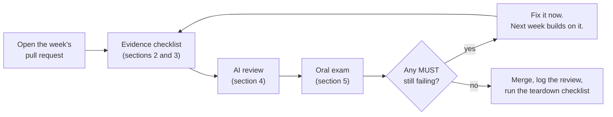

# Weekly Self-Review

You have no mentor on this assignment. This document replaces the three things a mentor would have done:

| A mentor would | You do instead | Section |
| --- | --- | --- |
| Check the work against the Definition of Done | Tick an evidence checklist | 2 and 3 |
| Read your pull request and find what you missed | Paste the pull request into an AI session with a strict review prompt | 4 |
| Point at a random block and ask "what does this do, and why?" | Answer the week's questions out loud, then let an AI examine you | 5 |

Budget **90 minutes** at the end of each week. It is already inside the last task of every week in the execution guidelines.

## 1. The loop



Two rules make this honest:

1. **Evidence, not belief.** Every tick needs something you can point at: a link to a workflow run, a command and its output pasted into `NOTES.md`, a screenshot. "I am fairly sure it works" is not a tick.
2. **You review before the AI does.** The AI finds what you missed; it does not replace looking. If you paste first and read later, you learn nothing from the week.

## 2. Checks that apply every week

```text
[ ] The week's work is on its own branch and arrives in main through ONE pull request
[ ] Every required check on that pull request is green, and I did not bypass the ruleset
[ ] Commits are small and their messages say what changed and why (no "wip", no "fix")
[ ] No secret, token, password, .env file or Terraform state file is in the diff or the history
[ ] I can explain every line I added, including every line an AI suggested
[ ] README and docs describe what exists NOW, not what I planned
[ ] NOTES.md has this week's entries: what I tried, what confused me, what I decided and why
[ ] Hours actually spent are written next to each task's estimate
[ ] (From Week 3) the end-of-session checklist ran after the last session, and the cost log is up to date
```

## 3. Evidence checklists by week

Each line is a claim. Next to it in `NOTES.md`, put the proof.

### Week 1: CI and containers

```text
[ ] A pull request with a failing test CANNOT be merged (link to the blocked pull request)
[ ] A pull request with a lint error fails in under two minutes
[ ] Coverage is reported in the job summary and the job fails below 90 percent
[ ] The image is built once per commit and tagged with the commit SHA, never only "latest"
[ ] docker pull ghcr.io/<me>/<repo>:<sha> works from a logged-OUT shell (the package is public)
[ ] The image runs as a non-root numeric user: docker run --rm <image> id
[ ] The image is at least 5x smaller than the starting one (both sizes written down)
[ ] /version from the running container returns the commit SHA it was built from
[ ] A HIGH or CRITICAL vulnerability with a fix available turns the pipeline red (shown once, on purpose)
[ ] The fake leaked secret was caught: by pre-commit locally AND by the pipeline (both shown)
[ ] Every action is pinned to a 40-character SHA with a version comment
[ ] Every job declares permissions, and none has more than it needs
[ ] AWS preflight output is in NOTES.md; the vCPU quota is 2 or more, or an increase is requested
```

### Week 2: Kubernetes on the laptop

```text
[ ] helm upgrade --install on a fresh kind cluster reaches "all pods Ready" with one command
[ ] scripts/smoke.sh passes against http://localhost:8080
[ ] The database password is not in git, not in values.yaml, not in the rendered templates
[ ] kubectl describe pod shows three probes, CPU and memory requests, and a memory limit
[ ] The container runs as non-root with a read-only root filesystem and all capabilities dropped
[ ] Deleting the API pod: a new one serves traffic, and the parcels are still there
[ ] Deleting the PostgreSQL pod: data survives, because it lives in a volume
[ ] A bad release (failing readiness) never receives traffic, and Helm rolls it back by itself
[ ] The k8s-smoke workflow goes red when a probe path is wrong (shown once, on purpose)
[ ] helm template output passes kubeconform with no errors
[ ] I can draw, from memory, how a request reaches a pod: port mapping, Service, endpoints, pod
```

### Week 3: Terraform on AWS

```text
[ ] terraform plan on an unchanged stack says "No changes"
[ ] State is in S3 with versioning on; no state file exists in git or its history
[ ] The instance has no SSH key, no port 22, no port 6443; only 80 is open
[ ] aws ssm start-session gives a shell, and k3s reports one Ready node
[ ] No IAM user access key exists in the account: aws iam list-access-keys returns none
[ ] A pull request that changes Terraform shows its plan before merge
[ ] Apply runs only after I approve it in the infra environment (screenshot of the waiting run)
[ ] The plan role cannot change anything (shown: an action it is denied)
[ ] Each role's trust policy matches exactly one subject, with StringEquals and no wildcard
[ ] Destroy, then apply, produced a working node again with no manual step
[ ] The dead-man switch works: tested once with a short timer
[ ] scripts/end-of-session.sh reports nothing left after destroy
```

### Week 4: Deploy and observe

```text
[ ] The deploy workflow deploys a commit I choose, after my approval, with no laptop involved
[ ] After a deploy, /version on the public IP returns the commit SHA I chose
[ ] The deploy role can do three things and nothing else (policy pasted in docs)
[ ] The bad-deploy drill: pipeline red, previous version still serving, nothing done by hand
[ ] The database password on the node was generated at boot and appears in no log
[ ] Prometheus on kind shows the tracker target as UP
[ ] The dashboard shows request rate, error ratio and p95 latency, and survives a Grafana restart
[ ] An alert fired when I raised the error rate, and cleared when I lowered it (screenshots)
[ ] The SLO is written as a number with a measurement window, and the alert relates to it
[ ] The runbook has at least one failure written up with exact commands
```

### Week 5: Prove it

```text
[ ] Full rebuild from an empty AWS account state to a serving app: time recorded, zero manual steps
[ ] Every drill in the game-day table has dated evidence
[ ] The runbook covers three failures and I followed each one cold, without my notes
[ ] The cost report states credits used, instance hours, and the cost of running all month
[ ] Each pipeline role's permissions are narrower than at the end of Week 4, with the reason
[ ] A fresh clone, following only the README, works on the first attempt
[ ] The architecture diagram matches what is actually deployed
[ ] Known limitations are listed honestly, with what I would do next
[ ] The demo is recorded, under 12 minutes, and shows at least two failures being handled
[ ] Final teardown done; end-of-session script clean; credits remaining written down
```

## 4. AI review of the pull request

### 4.1 Prepare the material

From the repository, on the week's branch, with the pull request open:

```bash
PR=<number>
gh pr view "$PR" --json title,body,files --jq '.title, .body, (.files[].path)' > /tmp/pr-summary.txt
gh pr diff "$PR" > /tmp/pr.diff
wc -l /tmp/pr.diff
```

If the diff is longer than about 1,500 lines, review it in two passes (for example workflows first, then everything else). A reviewer, human or AI, stops reading carefully somewhere around there.

Before you paste, look at the diff yourself for anything that must not leave your machine: a real password, a token, Terraform state. Your repository is public, so the diff should contain nothing private. If it does, that is your first finding.

### 4.2 The review prompt

Start a **new** AI session, so it has no memory of helping you write the code and no reason to be kind about it. Paste this, filling in the three marked places.

```text
You are reviewing a pull request as a senior DevOps engineer who has to run this
system in production and will be paged when it breaks. I am a student doing a
self-taught assignment with no human mentor, so this review is the only one the
work gets. Be direct. Do not soften findings and do not praise anything unless
it is unusually good.

CONTEXT
- Project: a small FastAPI + PostgreSQL service ("tracker") that I did not write.
  My work is everything around it: GitHub Actions, Docker, Kubernetes (kind and
  k3s), Helm 4, Terraform on AWS, Prometheus.
- Constraints: zero cost (AWS Free plan), public GitHub repository, no long-lived
  credentials anywhere, GitHub OIDC to AWS, actions pinned by commit SHA.
- This pull request is my work for WEEK <N>: <one line describing the week>.

THE WEEK'S DEFINITION OF DONE
<paste the Definition of Done for this week from assignment/execution-guidelines.md>

THE PULL REQUEST
<paste /tmp/pr-summary.txt, then /tmp/pr.diff>

WHAT I WANT FROM YOU, IN THIS ORDER

1. Verdict against the Definition of Done. Go through it line by line and mark
   each line: MET (say which part of the diff shows it), NOT MET, or CANNOT TELL
   FROM THE DIFF (say what evidence I should show you).

2. Findings, most severe first, at most ten. For each one give: the file and
   line, what is wrong, a concrete way it fails or gets exploited, and the
   direction of the fix in one sentence. Do NOT write the fixed code for me.
   Look in particular for:
   - secrets or credentials in any form, including in comments, defaults and
     example values
   - workflow security: missing or over-broad `permissions`, untrusted input
     interpolated into `run:` steps, `pull_request_target`, actions not pinned
     to a full SHA, secrets exposed to steps that do not need them
   - IAM: wildcards in actions or resources, trust policies that match more
     than one exact subject, roles that can escalate their own privileges
   - Docker: running as root, build tools or dev dependencies in the final
     image, unpinned base image, poor layer caching
   - Kubernetes: missing probes, requests or limits, writable root filesystem,
     secrets in values or manifests, `latest` tags, selectors that can drift
   - Terraform: hard-coded ids, anything that bills by the hour that the design
     did not ask for (NAT gateway, load balancer, Elastic IP), state or secrets
     in outputs
   - reliability: steps that can pass while the thing they check is broken,
     missing timeouts, no rollback path, no concurrency control on deploys
   - anything that works only on my machine

3. Things I did that will hurt in the next weeks even though they pass today.

4. Five questions that test whether I understand what I built. Ask them one at
   a time after the review, wait for my answer, and tell me plainly when an
   answer is wrong or vague.

RULES FOR YOU
- If you are not sure whether something is still true for current tool versions
  (Helm 4, Terraform 1.15+, GitHub Actions in late 2026), say you are not sure
  and tell me what to check in the official documentation. Do not state version
  numbers, flag names or action inputs from memory as fact.
- If the diff does not show something, say so. Do not assume it exists.
- Do not suggest adding tools or features beyond the Definition of Done.
```

### 4.3 What to do with the answer

An AI reviewer is confidently wrong some of the time, especially about anything that changed in 2026 (see the research report, section 3). So every finding gets triaged, not obeyed.

| Finding | Type | My decision | Reason |
| --- | --- | --- | --- |
| | MUST fix before merging | | |
| | Fix later (issue opened) | | |
| | Disagree | | Checked against: (link to official documentation) |

Rules for triage:

- A finding about a **secret, a credential or a trust policy** is fixed before merging. No exceptions.
- A finding that contradicts `assignment/verified-versions.md` or current official documentation is the AI being out of date. Write "disagree" and the link. That row is evidence of judgement, and it is worth keeping.
- If you cannot tell who is right, the official documentation of the tool decides. Not the AI, not a blog, not this kit.

Paste the finished table into the pull request as a comment before you merge. In six months that comment shows how you work better than the code does.

## 5. The oral exam

### 5.1 First, out loud, alone

For each question below, answer **out loud** (or in writing without looking anything up) for about a minute. If you stall, that is the gap. Write the question number in `NOTES.md` and go and close it.

**Week 1**
1. A pull request from a stranger's fork runs your workflow. What can it read, and what stops it reading more?
2. Why does the image get a tag made from the commit SHA, and what goes wrong with `latest`?
3. Your pipeline scans the image for vulnerabilities. Name two ways the scan itself could be the weakness.
4. The Dockerfile copies `requirements.txt` and installs before it copies the code. What does that order buy you?
5. What exactly does `permissions: contents: read` at job level change, compared with leaving it out?

**Week 2**
1. A pod is Running but receives no traffic. List the places you look, in order.
2. What is the difference between a failing liveness probe and a failing readiness probe, in terms of what Kubernetes does next?
3. Why is PostgreSQL a StatefulSet and the API a Deployment?
4. The migration step: where does it run in your chart, and what happens when two replicas start at once?
5. What does a memory limit do when the container exceeds it, and how is a CPU limit different?

**Week 3**
1. What is in the Terraform state file, and what are the two bad things that can happen to it?
2. Walk through how a GitHub job gets AWS credentials without any secret being stored. Name each party and what it checks.
3. Your trust policy uses `StringEquals` on `sub`. What would `StringLike` with a `*` allow that you do not want?
4. What makes your subnet "public"? What single resource, if deleted, would cut the instance off?
5. Why two stacks, and why is one of them applied from a laptop?

**Week 4**
1. The pipeline is green. What exactly has been proven, and what has not?
2. Trace a deploy from "Run workflow" to a new pod serving traffic. Name every identity involved.
3. What does `--rollback-on-failure` do, and what kinds of bad release would it NOT catch?
4. Your alert uses `rate(...[5m])`. Why a rate, why five minutes, and what happens if the pod restarts?
5. What is your SLO, how did you choose the number, and how much failure does it permit per week?

**Week 5**
1. Your instance is gone and so is your laptop. What do you need in order to rebuild, and where is each thing?
2. Which of your three roles would do the most damage if its credentials were stolen, and what limits that damage?
3. What would this cost per month running all day, and which line of the bill is largest?
4. Name three things a real team would need that this project does not have.
5. If you started again, what would you do in a different order?

### 5.2 Then, examined

When you can answer the five, test whether the answers hold. In a new AI session:

```text
Act as an interviewer for a junior DevOps role. I built a project with GitHub
Actions, Docker, Kubernetes (kind and k3s), Helm 4, Terraform on AWS with GitHub
OIDC, and Prometheus. This week I worked on: <one line>.

Ask me ONE question at a time about how and why it works. After each answer:
tell me in two sentences what was right, what was wrong or missing, and then ask
a follow-up that goes one level deeper on the weakest part of my answer. Do not
explain the full answer unless I say "I give up" - make me reason it out. After
six questions, list the three topics I should study before a real interview.
```

Ten to fifteen minutes is enough. The follow-up questions are the value: they are what a mentor's "why?" would have done.

## 6. Review log

Keep one row per week in `NOTES.md`.

| Week | Date | MUST items failing at first check | Findings from AI review (fixed / deferred / disagreed) | Weakest oral-exam topic | Hours: planned / actual |
| --- | --- | --- | --- | --- | --- |
| 1 | | | | | 22 / |
| 2 | | | | | 22 / |
| 3 | | | | | 22 / |
| 4 | | | | | 22 / |
| 5 | | | | | 22 / |

The "weakest topic" column is the one to read again before any interview.
